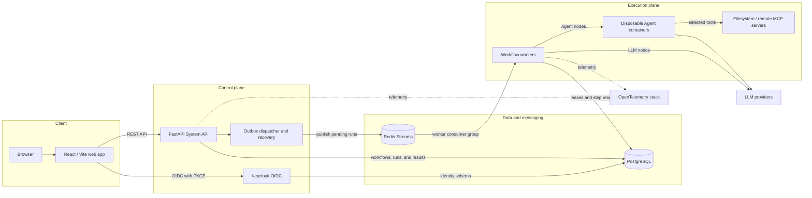

# AgentFlow

AgentFlow is a self-hosted platform for designing and running workflows through a
drag-and-drop interface. Workflows can transform data, branch, run independent
steps in parallel, call LLMs, and start isolated Agent runtimes with MCP tools.

## Run AgentFlow

### Requirements

- Docker Desktop, or Docker Engine with Docker Compose v2
- Enough resources to build and run the application services and Agent images

### Start locally

Run these commands from the repository root:

```powershell
Set-Location docker
Copy-Item .env.example .env
# Replace the sample passwords in .env before starting the stack.
docker compose up -d --build
```

The first build can take several minutes because Compose builds the web app,
backend, MCP server, and Agent runtime images.

| Component | Address |
| --- | --- |
| Web UI | <http://localhost:3000> |
| System API | <http://localhost:8000> |
| API reference | <http://localhost:8000/docs> |
| Keycloak | <http://localhost:8080> |

Sign in with `KEYCLOAK_DEV_USER` and `KEYCLOAK_DEV_USER_PASSWORD` from
`docker/.env`.

### Configure and run a workflow

1. Open **Models**, add a provider API key, and enable the models the workflow
   may use.
2. If an Agent needs tools, add or enable an MCP server and select it on the
   Agent node.
3. Create a workflow, add nodes, and connect them on the canvas.
4. Configure each node and select **Save changes**.
5. Validate and publish the workflow.
6. Run it and inspect the output and status of each step.

The editor saves valid graph changes automatically. Publishing waits for the
latest draft to be saved, so there is no separate **Save draft** action.

### Test providers without API keys

For a local demonstration, start the provider-mock override instead of the base
stack alone:

```powershell
docker compose -f compose.yaml -f compose.provider-mock.yaml up -d --build
```

In **Models**, use one of these test keys:

| Provider | API key | Model |
| --- | --- | --- |
| OpenAI | `test-openai-key` | `test-chat-model` |
| Anthropic | `test-anthropic-key` | `test-claude-model` |
| NVIDIA | `test-nvidia-key` | `test-chat-model` |

The mock provider is intended only for local use and automated tests.

### Optional observability

Start the OpenTelemetry, Prometheus, Loki, Tempo, Alloy, Grafana, and Langfuse
services with the optional overrides:

```powershell
docker compose `
  -f compose.yaml `
  -f compose.observability.yaml `
  -f compose.langfuse.yaml `
  up -d --build
```

Grafana is available at <http://localhost:3001> and Langfuse at
<http://localhost:3002>. Their credentials are configured in `docker/.env`.
Change every sample password, salt, encryption key, and public/secret key before
using these services outside a local environment.

### Operate the local stack

Run these commands from `docker`:

```powershell
docker compose ps
docker compose logs -f system workflow-worker web
docker compose down
```

`docker compose down` preserves named volumes. Adding `--volumes` permanently
deletes the PostgreSQL database, Redis data, provider-encryption key, and MCP
files created by the stack.

If the UI is unavailable, check `docker compose ps` first, then inspect the logs
for `system`, `workflow-worker`, `keycloak`, `postgres`, and `redis`. A workflow
that remains pending usually means the worker or Redis is unavailable; a failed
Agent step should be checked in the worker logs.

### Deploy to a server

The repository provides two Compose overrides:

| Environment | Compose files | Environment file |
| --- | --- | --- |
| Server test | `compose.yaml`, `compose.dev.yaml` | `.env.dev` |
| Production | `compose.yaml`, `compose.prod.yaml` | `.env.prod` |

For a server test that builds from source:

```powershell
Copy-Item .env.dev.example .env.dev
# Set secrets and the WEB, SYSTEM, and KEYCLOAK public URLs.
docker compose --env-file .env.dev -f compose.yaml -f compose.dev.yaml up -d --build
```

Production pulls prebuilt images whose names are configured in `.env.prod`:

```powershell
Copy-Item .env.prod.example .env.prod
# Set all secrets, HTTPS public URLs, and immutable image names.
docker compose --env-file .env.prod -f compose.yaml -f compose.prod.yaml pull
docker compose --env-file .env.prod -f compose.yaml -f compose.prod.yaml up -d --remove-orphans
```

Do not run an override file by itself. In production, place the web app, System
API, and Keycloak behind an HTTPS reverse proxy and back up the named volumes
before upgrades. Agent execution currently requires access to the Docker socket;
that grants host-level Docker control, so production deployments should move the
runner to a dedicated, restricted host before accepting untrusted workloads.

## Architecture



### Components and responsibilities

| Component | Responsibility |
| --- | --- |
| React/Vite web app | Authentication, provider and MCP configuration, visual workflow editing, publishing, and run inspection |
| Keycloak | OIDC login using Authorization Code with PKCE |
| FastAPI System API | Workflow and model APIs, validation, persistence, outbox dispatch, and recovery |
| PostgreSQL | Authoritative workflows, immutable published versions, runs, step results, provider configuration, and durable commands |
| Redis Streams | Delivery of pending workflow runs to the worker consumer group |
| Workflow workers | Graph scheduling, bounded parallel node execution, cancellation, timeouts, and run/step persistence |
| Agent runtimes | Single-use containers for the default, Codex, OpenCode, and OpenHands adapters |
| MCP servers | Tools exposed to selected Agent nodes; the bundled filesystem MCP uses a private runtime network |
| Observability stack | Optional traces, metrics, logs, dashboards, and LLM observations |

### Workflow execution

Each publish creates an immutable workflow version. Starting a run stores the run
and an outbox record in PostgreSQL before the dispatcher sends it to Redis. A
worker claims the message, renews a database lease, and schedules ready nodes from
the published graph. Independent nodes can run concurrently up to the workflow's
`maxParallelNodes` limit.

Step results are written back to PostgreSQL. Durable stop commands are also
broadcast through Redis for prompt cancellation. The recovery controller detects
expired leases and workflow deadlines, marks abandoned work as failed, and removes
orphaned Agent containers. PostgreSQL remains the source of truth if Redis is
restarted or a message must be dispatched again.

### Agent isolation

Every Agent-node attempt starts a fresh runtime container selected by the node's
runtime setting. The worker sends a JSON request over standard input, injects the
selected provider and model credentials only for that attempt, receives a JSON
result, and removes the container. CPU, memory, process, timeout, output-size, and
container-concurrency limits are enforced by the supervisor.

The included runtime catalog contains:

- `default`: Deep Agents/LangGraph runtime
- `codex`: OpenAI Codex CLI runtime
- `opencode`: OpenCode SDK/server runtime
- `openhands`: OpenHands Software Agent SDK runtime

### Data and network boundaries

PostgreSQL, Redis, provider-encryption material, and MCP files use separate named
volumes. The local stack binds service ports to loopback. Production overrides do
not expose PostgreSQL, Redis, or the filesystem MCP publicly; only the web app,
API, and identity service are intended to sit behind the reverse proxy.

Provider secrets are encrypted at rest and are not returned to the browser after
storage. Agent containers receive only the credentials and MCP access selected for
their node attempt.

For the reasoning, failure behavior, and implementation details behind these
patterns, see [Engineering solutions used in AgentFlow](docs/engineering-solutions.md).

License: [MIT](LICENSE).
