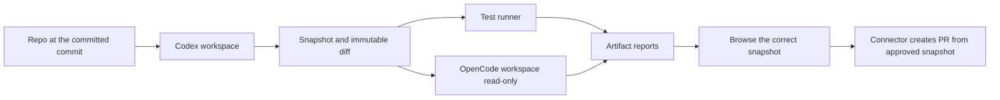

# Integrating Agents into workflows

> The mapping from current code to image, credential, contract v1/v2 and Codex/OpenCode deployment plan are separated at [Integrate Codex and OpenCode into AgentFlow](codex-opencode-runtime-integration.md).

> Runtime OpenHands Software Agent SDK is described separately at [OpenHands Integration](openhands-runtime-integration.md).

## Current deployment direction: Deep Agents first

> **Architectural update:** The target production pipeline does not use a persistent HTTP service agent. Each agent node attempt will run in a disposable container; see [ephemeral agent runtime design](ephemeral-agent-runtime.md). HTTP/CLI in this document is still the contract and adapter testing surface.

Under the new scope, use [default Python agent in `src/agents/default`](../src/agents/default/README.md) as the first runtime. Agent uses `create_deep_agent` on LangGraph, a node catalog and output tool with schema to suggest a small workflow plan. There are CLI JSON stdin/stdout, synchronous `POST /v1/runs` and a demonstration Node.js client. Other runtimes are added according to [directory convention and contract container](../src/agents/README.md).

Test path: **task/context → Deep Agents → Real LLM → WorkflowPlan JSON → agent node output**. Runtime calls OpenAI-compatible Chat Completions API or Anthropic according to configured provider/model; There are no fake model branches. The result is a recommendation, which has not yet translated itself into a DSL or action implementation.

Contract v1 one-shot already has Codex CLI adapter and OpenCode SDK/server. The model has not yet implemented contract `startOrAttach`, workspace, persistent streaming, approval or recovery in the sections below; The content is extension design v2.

Vendor document verification date: **October 12, 2026**. Contract v1 is already running using the adapter; The session/workspace v2 interfaces below are still the proposed design.

## 1. Selecting the integration surface

| Runtime | The way to integrate has been described by the official documentation | Recommended for AgentFlow |
| --- | --- | --- |
| Codex SDK | TypeScript/Python SDK, create/resume/resume thread | Choose typed instead of CLI when the adapter needs thread control |
| Codex App Server | Bidirectional JSON-RPC, thread/turn, streamed events and approvals | The stage needs interactive UI between turn; Prioritize internal stdio runner |
| Codex CLI | `codex exec --json`; `--output-schema` gives structured results | Current Contract v1 one-shot |
| OpenCode server | `opencode serve`, HTTP/OpenAPI | Runtime runs in a sandbox, not a direct public endpoint |
| OpenCode SDK | `@opencode-ai/sdk`, manages sessions, sends prompts, aborts and streams SSE events | MVP via SDK connects server in runner |

Source for Codex SDK: [Codex SDK](https://developers.openai.com/codex/sdk/). `codex mcp-server` has been removed; do not select it as the new integration platform.

The worker transmits the selected MCPs via `AGENT_MCP_SERVERS` to exactly one container. The default runtime loads the tool with `langchain-mcp-adapters`, supports Streamable HTTP and SSE, and prefixes the tool name according to the server slug to avoid duplicate names. Runtime Codex maps the same contract to `mcp_servers.<slug>`; OpenCode maps to remote `mcp` and only allows tools of the selected server. Both support Streamable HTTP and reference headers via environment so no secret is set in argv/config. The authentication header is encoded in the database and is not in the graph/version or stdin payload. The configuration is compared against the official [Codex MCP](https://developers.openai.com/codex/mcp/) and [OpenCode MCP](https://opencode.ai/docs/mcp-servers/).

App Server uses JSON-RPC with a different wire format: remove the `jsonrpc` field; stdio uses JSONL. Transport WebSocket is currently labeled experimental/unsupported. AgentFlow should wrap stdio with its gateway when remote access is needed. Source: [Codex App Server](https://learn.chatgpt.com/docs/app-server).

CLI provides JSONL event and output schema; need to parse event, check end status and validate output. Source: [Codex non-interactive mode](https://learn.chatgpt.com/docs/non-interactive-mode).

OpenCode SDK is a JS/TS client for the server, with `session.create`, `session.prompt`, `session.abort`, `event.subscribe`; The server publishes the API via HTTP/OpenAPI. Source: [OpenCode SDK](https://opencode.ai/docs/sdk/), [OpenCode Server](https://opencode.ai/docs/server/).

Do not attach a fixed model name to the engine. Model/provider is project-based configuration; Which providers the runtime supports must be verified in the locked version. Session Codex and session OpenCode are two separate formats, not converted back and forth by changing the provider name.

## 2. What to verify in the PoC

Online documentation pages are subject to change; Even in the OpenCode SDK, there is an example where the structured output uses `format`, but in the method table it mentions `outputFormat`. Therefore, the PoC must check the type/OpenAPI of the installed package before finalizing the mapping. Do not consider the paragraphs below as examples of SDKs that can be copied and run immediately.

Each release of AgentFlow needs to maintain a compatibility table:

| Information | Values to collect during the PoC |
| --- | --- |
| CLI/server/SDK version | Actual version; undefined in this document |
| Container image digest | Immutable image to reproduce runner |
| Protocol hash schema | Schema generated or corresponding OpenAPI runtime |
| Auth mode | The project's credentials can be used in headless runner |
| Capabilities | Streaming, structured output, resume, cancel, interactive approval |
| Recovery behavior | Behavior when API connection is lost, worker dies, server dies and volume is lost |
| Usage coverage | Which token/cost is paid by the provider; somewhat just an estimate |

## 3. Adapter contract

Illustrative TypeScript contract defined by AgentFlow; not vendor SDK:

```ts
type Json = null | boolean | number | string | Json[] | { [key: string]: Json };

interface AgentCapabilities {
  streaming: boolean;
  structuredOutput: boolean;
  resumeSession: boolean;
  cancel: boolean;
  interactiveApproval: boolean;
}

interface AgentStartInput {
  tenantId: string;
  projectId: string;
  runId: string;
  nodeExecutionId: string;
  operationKey: string;
  leaseGeneration: number;
  prompt: string;
  modelRef: string;
  workspaceRef: string;
  inputArtifacts: string[];
  outputSchema: Record<string, Json>;
  credentialRef: string;
  policyRef: string;
  deadlineAt: string;
  budget: { maxEstimatedCostUsd: number; maxTurns: number };
}

interface AgentHandle {
  jobId: string;
  sessionRef: string;
}

type AgentEvent =
  | { kind: "progress"; cursor: string; text: string }
  | { kind: "approvalRequired"; requestRef: string; actionHash: string }
  | { kind: "completed"; resultRef: string }
  | { kind: "failed"; code: string; retryable: boolean };

interface AgentAdapter {
  capabilities(): AgentCapabilities;
  startOrAttach(input: AgentStartInput): Promise<AgentHandle>;
  inspect(handle: AgentHandle): Promise<{
    state: "running" | "waiting" | "completed" | "failed" | "unknown";
    resultRef?: string;
  }>;
  events(handle: AgentHandle, after?: string): AsyncIterable<AgentEvent>;
  cancel(handle: AgentHandle): Promise<void>;
  respondToApproval?(handle: AgentHandle, decisionRef: string): Promise<void>;
}
```

`startOrAttach`, cursor replay, lease and result store secured by **AgentFlow supervisor**; The runtime SDK does not provide those properties by default. CredentialRef only resolves at the trusted edge; Do not include secrets in Workflow history or JSON graphs.

`resumeSession` is the ability to resume saved conversations. Reattach job running is a supervisor and transport capability. If the requested node feature is not supported, reject it at publish or preflight instead of successfully emulating it.

## 4. Node agent life cycle

1. Finalize workflow/node version, model, policy, input hash, repo commit and budget.
2. Supervisor creates isolated workspace and runner job according to operation key.
3. Adapter opens runtime, creates or finds recorded session; Save the mapping before sending the turn when the protocol allows it.
4. Start the turn, converting the supplier event into a standard event; hide secret before saving log.
5. When the turn ends, validate the JSON Schema, collect diff, log, usage and output manifest.
6. Runner saves the manifest before reporting, so that retry can retrieve the results.
7. Activity returns small output and artifact reference; workflow decides the next node.
8. Cleanup workspace/process according to retention and run results; cleanup must be idempotent.

The gap of creating a session/sending a turn and then losing the ACK can cause orphaned sessions or duplicate turns. Adapter must inspect/reconcile; Just having an internal key is not enough to ensure that the provider does not receive two prompts. If the confirmed status cannot be found, report `unknown` and move the reconciliation process.

## 5. Runtime-specific mappings

### Codex

With the current v1 contract, start with `codex exec` in the image adapter because this interface matches one-shot jobs and supports output schema. Start process with executable + argv with `shell: false`, pass prompt as data/stdin, parse JSONL line by line, read final output separately and separate stderr. The SDK is the typed choice when thread control is needed; Use the specific thread ID when continuing work. Do not concatenate user input into shell commands.

When adding App Server: complete handshake `initialize`/`initialized`, manage request ID, thread ID, turn ID and permission requests. Approval response must be associated with a pending request on the correct connection. Generate the schema according to the locked binary and test the adapter with that schema. This is a deployment plan based on [App Server protocol and message schema](https://learn.chatgpt.com/docs/app-server).

### OpenCode

Supervisor runs a server within the isolated workspace/tenant; adapter creates internal client. Subscribe to events before sending prompts to reduce stream gaps, filter by session/message ID, and always use session state/result to confirm completion.

Server has HTTP Basic Auth configured with `OPENCODE_SERVER_PASSWORD`; when going over the network requires TLS/private network and AgentFlow authentication. Do not let the browser call the server directly or consider CORS as decentralized. Runtime auth information: [OpenCode Server — Authentication](https://opencode.ai/docs/server/).

OpenCode supports permission configuration `allow`, `ask`, `deny`. AgentFlow must proactively render policies according to project/runtime version. Source: [OpenCode Permissions](https://opencode.ai/docs/permissions/).

## 6. Between-turn approval and workflow approval

| Type | Recommended way | Limit |
| --- | --- | --- |
| Workflow Approval node | Once the agent creates the artifact, the runner can close; Temporal waiting for approval | Suitable for waiting many hours/day |
| Permission request between turn | The adapter saves the request, the UI returns a decision, the adapter replies to the waiting runtime | May depend on process/connection being alive |

MVP prioritizes browsing at node boundaries. Agent creates diff/test report; connector has the right to create a PR that runs after approval. When the runtime issues a permission request outside of the MVP capability, fail/pause has a clear message; Don't turn on permissions to let it go.

For mid-turn approvals, set the waiting period shorter than the sandbox holding limit. If the runtime dies, the old request becomes stale. Continuing requires creating a new request after verifying the action is the same; Do not blindly replay old permission responses. No promise to continue exactly every unfinished shell command.

## 7. Workspaces, artifacts, and Agent handoff

Each run starts from the committed SHA commit, using its own checkout/snapshot. Git worktree helps with version management but is **not a security sandbox**. Two parallel agents do not write to the same working directory.

For example, Codex fixes the code and then OpenCode reviews:



Commit using task summary, commit SHA, diff/snapshot and JSON report. Do not copy Codex internal session data to OpenCode. If two branches modify the same code, a separate merge step is needed and a conflict report is needed; Automatic merge has not been included in MVP.

Artifact manifest includes ID, tenant/project, run/execution, checksum, content type, size, base commit, snapshot ref and creation time. Download via short URL after ACL check; Do not trust the file path returned by the model. Check path traversal, symlink and size when capturing artifacts.

## 8. Runner security boundary

This is a design requirement since the coding agent can run shell and repository code:

- The API/control plane does not execute repo or user plugin code.
- Runner runs non-root, limits CPU/RAM/PID/disk/time, does not mount Docker socket or host's home.
- Model credentials and connector calling permissions are isolated from untrusted test/script execution environments. Prioritize credential proxies with short-term tokens, clear quota and scope.
- Policy network blocks metadata service, private/control-plane endpoints; Check DNS resolution and redirect for HTTP node to limit SSRF.
- Repo README/AGENTS.md, issue text and tool output are inputs that may contain prompt injection. They are not self-promoted, credentialed, or published.
- Nodes that execute arbitrary code must run in an isolated runner similar to an agent; Do not use `eval` or Node `vm` as the sandbox boundary for the tenant.
- Separate permissions to edit workspace from Git push/create PR/deploy permissions. Publishing rights lie with the connector and check specific approvals.

For workloads from untrusted users, an enhanced sandbox or VM needs to be evaluated. gVisor uses application kernel to increase syscall isolation; Still need to check compatibility and host/network policies. Source: [What is gVisor?](https://gvisor.dev/docs/).

## 9. Costs and errors

The budget must apply across the run, including parallel and retry nodes. Before calling provider, reserve budget in ledger; After having usage, reconcile the used part. If you cannot receive usage, write `unknown`, do not write 0. Cost estimate is saved with pricing version; The price of the model in this design has not been finalized yet.

Token usage is usually only available after part or all of the turn, so AgentFlow's budget may be slightly exceeded in the running task. If you want tight limits, you need a gateway/quota provider, concurrency and timeout limits; do not promise an application counter is a hard billing cap.

Recommended standard error codes: `AUTH_REQUIRED`, `POLICY_DENIED`, `CAPABILITY_UNSUPPORTED`, `PROVIDER_RATE_LIMIT`, `OUTPUT_INVALID`, `WORKSPACE_LOST`, `SESSION_UNAVAILABLE`, `RESULT_UNKNOWN`, `BUDGET_EXCEEDED`, Keeping the original error code in the metadata masks sensitive data for debugging.
