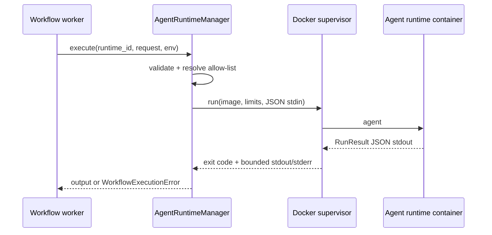

# Managing multiple Agent runtimes

Updated: **October 14, 2026**. Status: **target design for the current implementation slice**.

Concrete external-runtime implementation guidance is available in
[Integrating Codex and OpenCode with AgentFlow](codex-opencode-runtime-integration.md)
and [Integrating OpenHands](openhands-runtime-integration.md).

## 1. Goals

AgentFlow supports multiple independent Agent runtimes. Each runtime has its own
source, dependencies, and container image; workflows select a runtime per node
instead of forcing the entire stack to share one image.

This slice provides:

- the `src/agents/<runtime-id>` directory convention;
- a `runtime.json` manifest for image discovery, validation, and builds;
- management commands to list, validate, and build one or all runtimes;
- an `AgentRuntimeManager` in the worker that selects a runtime from an allow-listed catalog, sends JSON over `stdin`, and receives JSON over `stdout`;
- backward compatibility: `runtime: "agent"` maps to the default runtime.

This slice does not provide installation from external repositories, image hot
reload, long-lived sessions, streaming, between-turn approval, or API-triggered
image builds. Building is an administrative/deployment action, never a user-request
path.

## 2. Directory structure

```text
src/agents/
├── manage.py
├── default/
│   ├── runtime.json
│   ├── Dockerfile
│   ├── pyproject.toml
│   ├── uv.lock
│   ├── src/
│   └── tests/
└── <runtime-id>/
    ├── runtime.json
    ├── Dockerfile
    └── ...
```

`runtime-id` must be a lowercase slug containing `a-z`, `0-9`, and `-`, beginning
and ending with a letter or digit. Each direct directory is one build unit; a
runtime must not read another runtime's source or credentials.

## 3. The `runtime.json` manifest

Minimal manifest:

```json
{
  "schema_version": 1,
  "id": "default",
  "image": "agentflow-agent-default:0.1.0",
  "description": "Deep Agents/LangGraph runtime bundled with AgentFlow"
}
```

Rules:

- `schema_version` currently accepts only `1`.
- `id` must match the directory name.
- `image` is the full image reference used for builds and the worker catalog.
- `description` is an optional CLI/UI description.
- `Dockerfile` always lives in the runtime directory; the manifest cannot point the build context outside `src/agents`.

The manifest is deployment metadata and contains no API key, token, or model
configuration. Production images should be pinned to immutable versions or digests.

## 4. Container contract

Every runtime image must provide an `agent` executable on `PATH`. The supervisor
runs `agent` without arguments, sends exactly one UTF-8 JSON document over `stdin`,
and expects exactly one JSON document on `stdout`. Diagnostics go only to `stderr`.

Current request version:

```json
{
  "task": "Rendered task",
  "context": "{\"input\":\"serialized JSON\"}",
  "skills": [],
  "output_schema": {"type": "object"}
}
```

Successful result:

```json
{
  "run_id": "runtime-generated-id",
  "status": "succeeded",
  "mode": "live",
  "output": {}
}
```

Public failures use `{ "error": { "code": "...", "message": "..." } }` and a
nonzero exit code. The supervisor limits request/output size, timeout, CPU, memory,
PIDs, and network access and accepts only allow-listed error codes.

## 5. Builds and deployment catalog

Run management commands from the repository root:

```powershell
python src/agents/manage.py list
python src/agents/manage.py validate
python src/agents/manage.py build default
python src/agents/manage.py build --all
```

`build` invokes Docker with an argument array, using the runtime directory as the
build context and the manifest tag. Runtime names are always validated before use;
the CLI never interpolates user input into a shell command.

The worker neither scans the filesystem nor builds images. It runs only the
operator-supplied catalog:

```dotenv
AGENT_RUNTIME_DEFAULT=default
AGENT_RUNTIME_IMAGES={"default":"agentflow-agent-default:0.1.0","codex":"agentflow-agent-codex:0.1.0","opencode":"agentflow-agent-opencode:0.1.0","openhands":"agentflow-agent-openhands:0.1.0"}
```

The catalog is an allow-list. A node requesting an absent runtime must fail before
Docker is called. This separates permission to build/publish images from permission
to execute workflows and prevents graphs from selecting arbitrary image references.

## 6. Selecting a runtime in a workflow

An Agent node stores the runtime ID in `config.runtime`:

```json
{
  "type": "agent",
  "config": {
    "runtime": "default",
    "providerId": "...",
    "model": "..."
  }
}
```

Special values:

- `direct`: compatibility path that calls the provider in the worker without an Agent container.
- `agent`: legacy alias resolved to `AGENT_RUNTIME_DEFAULT`.
- a valid runtime ID: selects the corresponding `AGENT_RUNTIME_IMAGES` entry.

Workflow validation checks only the runtime-ID format because the catalog belongs to
deployment configuration and may differ between the control plane and worker. The
worker verifies registration before execution.

## 7. `AgentRuntimeManager`

The worker interacts with runtimes through one class:

```python
class AgentRuntimeManager:
    def available_runtime_ids(self) -> tuple[str, ...]: ...
    def resolve(self, runtime_id: str) -> AgentRuntimeDefinition: ...
    async def execute(
        self,
        runtime_id: str,
        request: dict[str, Any],
        *,
        environment_overrides: dict[str, str] | None = None,
    ) -> dict[str, Any]: ...
```

Invocation flow:



The manager uses a shared semaphore to limit total containers. Every invocation
creates a new container and always cleans it up after success, failure, timeout, or
cancellation. Credentials exist only in the invocation environment and never enter
the request, graph, or logs.

## 8. Acceptance criteria

1. `manage.py validate` detects invalid manifests, duplicate/mismatched IDs, and missing Dockerfiles.
2. `manage.py build <id>` uses the correct context and image tag; unregistered runtimes are rejected.
3. `AgentRuntimeManager` resolves the `agent` alias, selects images by runtime ID, and never accepts an image directly from a graph.
4. Two nodes in one deployment can select different runtime IDs when both are in the catalog.
5. Tests cover request/response behavior, security limits, missing runtimes, invalid catalogs, and `runtime: "agent"` compatibility.
6. Local/Compose documentation clearly describes image builds and catalog configuration.
