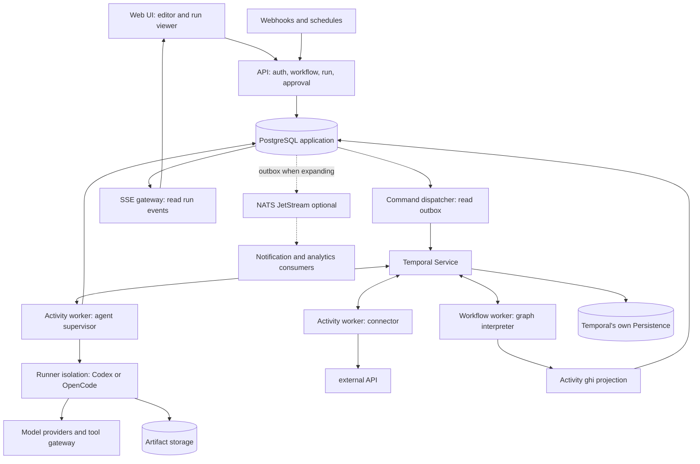

# AgentFlow architecture and technology

Research date: **September 5, 2026**. Status: **recommended to begin implementation**.

**PoC scope adjustment:** each Agent node runs a disposable container according to [contract `src/agents`](../src/agents/README.md). The catalog currently includes Python Deep Agents/LangGraph agents in `src/agents/default`, Codex CLI and OpenCode SDK/server; The persistent session/workspace contract in the section below is still the target architecture.

## 1. Objectives and assumptions

AgentFlow helps users put work into a visual graph: receive webhooks, call APIs, transform data, run agents, run tests, wait for approval and transfer results to other systems. The coding agent is managed as an execution resource with sessions, workspace, tool permissions, and cost limits.

Assumptions for choosing architecture:

- Start with a self-hosted version for a group; Design data with tenant/project to expand later.
- The development team is familiar with TypeScript; browser user interface; runner production prioritizes Linux.
- Agent tasks can last many minutes; The approval process can last for many days.
- Prioritize restoring work, observing progress and controlling external impacts over optimizing sub-millisecond latency.
- MVP handles JSON and artifacts; No need for a marketplace, real-time collaborative editing, or compatibility with all n8n workflows.

This is a design assumption that needs to be adjusted based on the number of users, actual load, and specific deployment requirements.

## 2. Product differentiation should be focused

AgentFlow should not be positioned as just “workflow with AI”. n8n already has the ability to use browsers for AI Agent tool calls, for example via Gmail. The proposed focus for AgentFlow is on agent coding lifecycle management: workspace, diff, testing, sessions, task cancellation, and handover between runtimes. Reference source: [n8n Gmail — Human-in-the-loop for AI tool calls](https://docs.n8n.io/integrations/builtin/app-nodes/n8n-nodes-base.gmail/message-operations/).

| Concept | Meaning in AgentFlow |
| --- | --- |
| Workflow | Graph definition has version |
| Run | One run of the workflow with the specified input and permissions |
| Node execution | One time node activation; contains one or more attempts |
| LLM node | Send input to model, receive output; usually no need for a repo or shell |
| Agent node | Runs a runtime that has a self-determining tool call loop and context management |
| Connector node | Specific operations with external systems, with clear schema and credentials |
| Workspace | The checkout/snapshot version is for work use, separated by run |
| Artifact | Diffs, reports, output files or test logs are saved and referenced by ID |

## 3. Proposed technology stack

The choices in the table are AgentFlow design decisions, not requirements of the tools.

| Class | Choose for MVP | Reasons and limitations |
| --- | --- | --- |
| Language, monorepo | TypeScript, Node.js LTS supported by SDK, pnpm workspaces | Share schema between UI, API and adapter; Lock the version when doing PoC |
| Interface | React + Vite + React Flow | Suitable canvas node/edge; The execution engine still has to be written server-side |
| UI state | Zustand for canvas; TanStack Query for server data | Separate edit state from run | state
| API | NestJS, REST and SSE | Split module workflow, run, credential, approval; SSE pushes one-way progress |
| Schema | JSON Schema + Ajv at node boundary | Validate configuration, input, output; Schema can be used outside of TypeScript |
| Workflow engine | Temporal + TypeScript SDK | Save history, coordinate step length, timer, signal and retry |
| Application database | PostgreSQL + Drizzle ORM | Transaction, unique key, JSONB, migration; The SQL is clear in the outbox | section
| Artifact storage | S3 or S3 compatible storage | Save diff/log/large files; The local MVP can use volumes via the same | interface
| Agent runtime | Codex adapter; OpenCode adapter | Isolate each provider's private API |
| Runner | Linux containers for internal environments; gVisor review for unreliable workloads | Separate the shell and repository code from the API/control plane |
| Observation | OpenTelemetry, structured logs; Prometheus/Grafana on deployment | Track trace, costs, timeouts and errors |
| Sign in | OIDC with group identity provider | Do not build your own password system; RBAC by project |
| External broker | Not used in MVP | Add NATS JetStream when multiple independent consumers are needed |

React Flow provides a JSON representation of nodes, edges, and viewports; AgentFlow will pass the semantics to its own DSL, not taking the canvas state as the entire executable contract. Source: [ReactFlowJsonObject](https://reactflow.dev/api-reference/types/react-flow-json-object).

OpenTelemetry provides telemetry creation, acquisition, and export components; The storage/dashboard backend is a native deployment choice. Source: [What is OpenTelemetry?](https://opentelemetry.io/docs/what-is-opentelemetry/).

## 4. System diagram

Blocks are logical responsibilities; MVP implements **modular monolith for API and several worker processes**, without needing each block to be a microservice. Each agent node attempt runs in a disposable container managed by the runner supervisor because the agent can have a shell and access the filesystem; Details are in [ephemeral agent runtime design](ephemeral-agent-runtime.md).

Temporal Service stores state, history and task queues; AgentFlow's Workflow/Activity code runs in the worker. Do not consider Temporal as a place to directly run the Codex binary.

## 5. Who owns which status?

| Data | Authoritative Source | How to use |
| --- | --- | --- |
| Workflow draft/version, membership, credential metadata | PostgreSQL application | Permissioned read/write API |
| Intent to start/cancel/browse | Command log + application outbox | Save before returning to confirm receipt of order |
| Coordination decisions, timers, recorded Activity results | Temporal history | Workflow worker recovers via replay |
| List of run/node status for UI | Projection in PostgreSQL | May be late; do not decide on the next node |
| Session agent and job status on runner | Session store/runner registry | Query adapter to reattach or reconcile |
| Files and snapshots | Artifact storage | Immutable, checksum, ACL by tenant/project |
| Domain events | Run event log and outbox | Play for UI/integration; does not replace Temporal history |

PostgreSQL applications and Temporal can be on the same database machine in small environments but must separate database/user; The application does not query or modify the Temporal internal table.

So that there are no two dispatchers, only the Workflow worker decides which node gets run next. A consumer of `node.completed` cannot launch a downstream node on its own. It only updates messages or data to serve queries.

## 6. Why choose Temporal?

Temporal supports restoring Workflow Execution using history and replay. Activities with the outside are expressed through Activities. This is suitable for flows that have long steps and wait for events. Source: [Temporal Workflow Execution](https://docs.temporal.io/workflow-execution).

| Plan | When appropriate | AgentFlow work still needs to be done |
| --- | --- | --- |
| Temporal — proposal | Restore, long wait for approval, many steps with retry | Graph interpreter, adapter, projection, idempotency and Temporal operation |
| BullMQ + PostgreSQL | Small demo, simple background tasks, the team accepts writing their own engine | State machine, scheduler, join, recovery, approval, versioning |
| Broker + self-written state machine | There are specialized requirements and distributed system operations teams | Mostly durable orchestration and debugging tools |
| LangGraph | Build your own agent loop, memory/checkpoint, subgraph AI | Integrate with business workflows, connectors and project permissions |

BullMQ is a job queue library based on Redis; queue capabilities and flow dependencies do not by themselves fulfill the AgentFlow product specification. Source: [BullMQ](https://docs.bullmq.io/). LangGraph has persistence/checkpoint; You can add one type of agent node when you need to build your own agent, no need to wrap Codex/OpenCode with LangGraph in MVP. Source: [LangGraph persistence](https://docs.langchain.com/oss/python/langgraph/persistence).

Choosing Temporal exchanges the cost of building the engine yourself for the cost of learning and operating the platform. If the goal is just to demo a short flow, BullMQ is a lighter option. With the assumption that there are long tasks and waiting for approval, we should PoC Temporal first and use a single engine for MVP.

## 7. Minimal data model

| Table | Key field/constraint |
| --- | --- |
| `tenants`, `projects`, `memberships` | Decentralization by tenant/project/user |
| `workflows` | Draft JSON, revision for optimistic locking |
| `workflow_versions` | Workflow ID, version, graph JSON, content hash; immutable |
| `runs` | Tenant, version ID, input ref, logical run ID, Temporal workflow ID, status projection, projection sequence |
| `node_executions` | Run ID, node ID, invocation ID, input/output refs, status |
| `node_attempts` | Execution ID, attempt, error class, start/end, lease generation |
| `agent_sessions` | Execution ID, provider, runtime version, session ID, workspace ref, runner ID |
| `runner_jobs` | Unique operation key, lease, generation, status, result manifest |
| `approval_requests` | Request ID, action hash, reviewer scope, expiry, decision, application status |
| `commands`, `outbox` | Idempotency key, command/event type, payload ref, number of attempts, next attempt |
| `run_events`, `consumer_inbox` | Unique Event ID; inbox locked by consumer + event ID |
| `artifacts` | Object key, checksum, content type, capacity, retention |
| `credentials` | Secret reference, provider, owner/project; Do not return secret to UI |
| `usage_records` | Operation/attempt, provider, tokens, cost estimate, pricing version |

All artifact, event, credential, and session queries must check tenant/project; Unpredictable UUIDs are not a decentralization mechanism. PostgreSQL row-level security can be an additional layer of protection, but the table master role or `BYPASSRLS` has an exception so the appropriate application role must be chosen. Source: [PostgreSQL Row Security Policies](https://www.postgresql.org/docs/current/ddl-rowsecurity.html).

## 8. Decide to delay

- Do not use Kafka, Elasticsearch or private vector databases without having a load/use case to prove the need.
- No need for Kubernetes for the first internal release; Supplemental when managing multiple runners or needing HA.
- MCP for tool/context connection; Do not use it as a workflow database or task queue.
- Do not automatically switch runtime when the agent is running. Converting Codex to OpenCode is a new execution with standardized input and delivery artifacts.
- Independent product development or extension of n8n requires separate assessment of UX, compatibility needs and licensing before reusing source code. This document recommends a standalone product and does not rely on copying the n8n engine.

Further details: [workflow storage and processing](workflow-execution.md), [event-driven](event-driven.md), [agent adapter](agent-integration.md), [workflow DSL](workflow-spec.md), [roadmap](roadmap.md).
