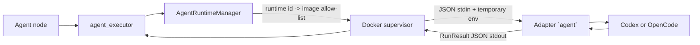
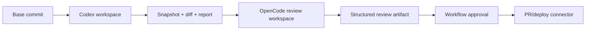

# Integrating Codex and OpenCode with AgentFlow

Update date: **October 12, 2026**. Status: **Codex and OpenCode contract v1 have been deployed, have contract tests and are loaded into the Compose catalog**.

This document describes how to include Codex, OpenCode, and similar agent runtimes in AgentFlow. The goal is to keep a stable contract on the workflow side, while any differences in CLI, SDK, sessions, events, and permissions are handled within each runtime's adapter.

Related documents:

- [Contract and catalog of multiple Agent runtimes](agent-runtime-management.md)
- [General agent integration design](agent-integration.md)
- [Disposable Container Lifecycle](ephemeral-agent-runtime.md)
- [Directory convention `src/agents`](../src/agents/README.md)

## 1. Architectural conclusion

Do not call Codex or OpenCode directly from a workflow worker. Each runtime is packaged into a separate image and provides executable `agent` under the AgentFlow contract:



Implementation direction is divided into two levels:

| Level | Scope | Can be used with existing systems |
| --- | --- | --- |
| Contract v1 — one-shot | One request, one JSON result, no session held, no approval between turn | Have; runtime `default`, `codex` and `opencode` have been hooked into Compose |
| Contract v2 — full agent coding | Workspace, diff/artifact, stream event, session/resume, cancel and approval | Not yet; need to extend supervisor, persistence and API/UI |

It is recommended to deploy v1 first for analysis, planning, or review tasks from a JSON context. Do not promote the ability to edit the repository until AgentFlow has mounted an isolated workspace and safely collected the artifact.

## 2. Current implementation status

### Existing pieces

- `src/agents/<runtime-id>` is an independent runtime unit, with `runtime.json` and `Dockerfile`.
- `src/agents/manage.py` discover, validate and build runtime.
- `AgentRuntimeManager` reads allow-list `AGENT_RUNTIME_IMAGES`, resolves `config.runtime` and prevents graph from transmitting arbitrary images.
- Each invocation runs the image in the new container using executable `agent`.
- Request and response go through JSON UTF-8; runtime log must go through `stderr`.
- Supervisor applies user `10001`, read-only root filesystem, drop capability, `no-new-privileges`, CPU/RAM/PID limit, timeout, output size and network.
- UI allows entering runtime id; `agent` is the default runtime alias and `direct` is the direct model call in the worker.
- Compose build images `default`, `codex` and `opencode` simultaneously, then transmit the `AGENT_RUNTIME_IMAGES` catalog to the worker.
- Worker maps selected provider to `AGENT_PROVIDER_BASE_URL` and `AGENT_PROVIDER_API_KEY`; All new runtimes use this credential contract instead of reading the key from `.env` themselves.
- `src/agents/codex` pin `@openai/codex@0.130.0`, run `codex exec --ephemeral`, use Responses API and structured output.
- `src/agents/opencode` pins `opencode-ai` and

### Missing or incomplete pieces

| Space | Impact on Codex/OpenCode |
| --- | --- |
| Model management currently only registers providers of type `openrouter` | The runtime receives credentials according to the common contract, but cannot directly select OpenAI/Anthropic providers until the Models page supports additional providers kind |
| Codex and OpenCode map `AGENT_MCP_SERVERS` to the runtime's own config | Both support Streamable HTTP, keep headers in the environment, and fail run if the required MCP fails to connect; SSE is only available in the default runtime |
| Container does not mount repository/workspace | The runtime can only handle `task` and `context`; Can't edit the actual code yet |
| Root filesystem read only, only `/tmp` is tmpfs `noexec` | The runtime must set temporary state, schema and output in `/tmp`; Do not assume a recordable home |
| Contract does not have a session, artifact, event, approval or runtime-native cancel | It is not possible to fully use the App Server or OpenCode server through a single JSON stdin/stdout |
| Supervisor only checks that `output` is object | Need to validate `output_schema` centrally; Not only does the runtime report success |
| UI uses static datalist, does not read catalog from worker | Users can import a runtime that has not been deployed and only detect errors when running |

Point to note: Codex v1 is currently suitable for one-shot work based on `task`, `context`, skills and JSON schema. The container does not have a workspace repository, so this is not a coding agent capable of editing files/commit/PR.

The model attached to the `codex` node must support the Responses API and tool semantics of the Codex CLI. Catalog Models does not currently have this preflight capability; The operator needs to enable a compatible Codex/GPT model on OpenRouter and the incompatibility error will be returned to the workflow instead of automatically changing the model.

## 3. Shared v1 contract

Executable `/usr/local/bin/agent` correctly reads a document from `stdin`:

```json
{
  "task": "Review the supplied change",
  "context": "{\"diff\":\"...\"}",
  "skills": [
    {
      "id": "...",
      "slug": "review",
      "name": "Code review",
      "version": 1,
      "content_hash": "...",
      "instructions": "..."
    }
  ],
  "output_schema": {
    "type": "object",
    "properties": {
      "summary": {"type": "string"}
    },
    "required": ["summary"]
  }
}
```

To succeed, only one document must be written to `stdout`:

```json
{
  "run_id": "runtime-generated-id",
  "status": "succeeded",
  "mode": "live",
  "output": {
    "summary": "..."
  }
}
```

Failed to write public error masked sensitive data and exit otherwise `0`:

```json
{
  "error": {
    "code": "PROVIDER_AUTH_ERROR",
    "message": "The runtime could not authenticate with the configured provider."
  }
}
```

Each adapter must:

1. Validate request before calling the provider runtime.
2. Combine `task`, `context` and skill instructions into prompts with clear boundaries; do not interpret context as privileged configuration.
3. Map the model/credential from the environment provided by AgentFlow, do not read the secret baked into the image.
4. Apply `output_schema`, parse the results and validate again before returning `RunResult`.
5. Write only `RunResult` or error envelope to `stdout`; runtime event/log moved to `stderr` with limits.
6. Run subprocess using executable and argv, do not combine user input into shell command.
7. Map provider errors to AgentFlow's public error code; Does not return raw response, token or stack trace.

Recommended structure:

```text
src/agents/
├── default/
├── codex/
│   ├── runtime.json
│   ├── Dockerfile
│ ├── package.json or pyproject.toml
│   ├── lockfile
│   ├── src/
│   └── tests/
└── opencode/
    ├── runtime.json
    ├── Dockerfile
    ├── package.json
    ├── lockfile
    ├── src/
    └── tests/
```

Manifest example:

```json
{
  "schema_version": 1,
  "id": "codex",
  "image": "agentflow-agent-codex:0.1.0",
  "description": "Codex one-shot adapter for AgentFlow"
}
```

## 4. Codex adapter

### Select the integration surface

| Surface | Suitable | Decision |
| --- | --- | --- |
| `codex exec` | Job headless/CI, prompt via stdin, JSONL event, output schema and output file | **Choose for contract v1** |
| Codex SDK | Control local threads using TypeScript or Python; start/continue/resume | You can replace the CLI wrapper when you need a typed API but still have one-shot at the AgentFlow edge |
| Codex App Server | Thread/turn, streamed events, approvals and customizable clients | **Choose for contract v2**, do not stuff into JSON stdin/stdout v1 |

Codex CLI supports `codex exec`, reading prompt from stdin, `--output-schema`, `--output-last-message`, event JSONL and resume session. Codex SDK supports start/continue/resume threads. App Server uses handshake `initialize`/`initialized`, then `thread/start` or `thread/resume`, `turn/start`, streamed notification and server-initiated approval request. Official source: [Codex SDK](https://developers.openai.com/codex/sdk/), [Codex CLI reference](https://developers.openai.com/codex/cli/reference/), [Codex App Server](https://developers.openai.com/codex/app-server/).

### Deployed v1 mapping

The Codex Adapter should implement the following flow:

1. Read and validate `RunRequest`.
2. Write `output_schema` to a random file under `/tmp`.
3. Create a prompt that includes the task, unreliable context, skill instructions, and a request that only returns JSON.
4. Parse `AGENT_MCP_SERVERS`; Map the Streamable HTTP server to `mcp_servers.<slug>`, set `required=true`, and pass the secret header to `env_http_headers` instead of argv.
5. Run `codex exec` with fixed argv, prompt via stdin, sandbox `read-only` for use case without workspace, schema and output file under `/tmp`.
6. Parse the resulting file; Do not take the last line of the log as the result.
7. Validate JSON Schema and wrap it into `RunResult`.
8. Delete auth state/temporary file when finished; Disposable containers continue to be the ultimate cleanup frontier.

Do not use `--dangerously-bypass-approvals-and-sandbox`. When AgentFlow has a workspace, switch to `workspace-write` only in the attempt's own checkout; Network and connector permissions are still controlled by AgentFlow policy.

### Authentication and model

- Do not perform browser login in container job.
- Codex CLI has headless login using API key or access token read from stdin; The credential must be resolved from the secret store for the correct invocation, placed in the temporary record area and not persisted to another job.
- Do not mount the host's personal Codex configuration directory into the container.
- The model from the node must be checked by the adapter with the actual provider/auth mode; Do not hard-code a default model into the engine.
- Need to add separate credential mapping for Codex runtime. Only add the necessary env names to the Codex image's allow-list, do not open passthrough to the entire worker environment.

### V2 mapping through App Server

When there is a session and UI interaction, the supervisor holds the following keys in persistence:

```text
runtime=codex
thread_id
turn_id
job_id
workspace_ref
event_cursor or internal sequence
runtime_version + image_digest
```

The adapter must complete the handshake on each connection, save `thread_id` before starting the turn when possible, normalize `turn/completed` as a terminal state, and convert the approval request into a persistent event. The approval decision must correctly attach `thread_id`, `turn_id`, `item_id` and the pending request; Do not replay old decisions for another action.

## 5. OpenCode adapter

### Select the integration surface

| Surface | Suitable | Decision |
| --- | --- | --- |
| OpenCode SDK + local server | Create session, prompt with structured output, abort and subscribe SSE | **Select for v1 and base for v2** |
| `opencode serve` + HTTP/OpenAPI | Separate client/server, inspect API and manage sessions from supervisor | Used for v2 or when a process independent adapter is needed |
| `opencode run --format json` | PoC CLI, raw event JSON | Only use smoke test; Clearer SDK for structured output |

OpenCode SDK can start the server and client at the same time or connect to an existing server. The SDK provides session create/prompt/abort, `format` for structured output and stream events. Headless server publishes OpenAPI, session APIs, SSE and permission response endpoint; HTTP Basic Auth is enabled with `OPENCODE_SERVER_PASSWORD`. Official source: [OpenCode SDK](https://opencode.ai/docs/sdk/), [OpenCode Server](https://opencode.ai/docs/server/), [OpenCode Permissions](https://opencode.ai/docs/permissions/).

### Deployed v1 mapping

The adapter currently executes the following flow:

1. Start OpenCode server on `127.0.0.1` in the same container using SDK helper that owns both server and client.
2. Subscribe to the event before sending the prompt so you don't lose the first event.
3. Create session in attempt's working directory.
4. Send the model as provider ID + model ID and transmit `output_schema` through `format: { type: "json_schema" }`.
5. Map MCP Streamable HTTP to remote `mcp`, disable automatic OAuth, confirm all selected servers have status `connected`, and only allow tools under `<server>_*`.
6. Filter events by session; Use event permission to fail closed, limit provider retry and abort before the supervisor's deadline instead of letting the request hang indefinitely.
7. Get the structured result from the response/session state, validate the schema and return `RunResult`.
8. Abort session and close server in `finally`, even if prompt or validation fails.

In implementation contract v1, the default permission is `{"*":"deny"}` and the adapter only adds `"<mcp-slug>_*":"allow"` for the selected MCP. If the runtime still generates the permission request event, the adapter aborts the session and returns `CAPABILITY_UNSUPPORTED` instead of automatically approving. OpenCode has fairly permissive defaults for many tools, so the adapter does not rely on the default of the runtime version.

### Authentication and configuration

- Generate temporary SDK config for invocation from provider/model authorized by AgentFlow; Do not read the host's project or home config.
- Use environment variable to reference secret; Do not write the API key value directly into config or log.
- Use `enabled_providers` to limit providers in jobs when appropriate.
- State, auth and config are temporarily placed in the attempt's own filesystem; Do not share `~/.local/share/opencode/auth.json` between tenants or containers.
- If running an HTTP server other than process/container, only bind loopback or private runtime network, turn on authentication and do not expose directly to the browser. CORS does not replace authentication/authorization.

### V2 mapping

Save `session_id`, last message ID, workspace ref and AgentFlow cursor event. SSE is only a live channel; After reconnecting, you must read the session status/messages to confirm the status instead of deducing that losing the stream means the job failed. Permission requests are converted into persistent events and responses are only sent back when the request still belongs to the correct session/action.

## 6. Credential and provider abstraction

AgentFlow now gets the model/API key from the provider registered in Models for every runtime container. The worker deletes the credential model that may exist in the process environment, decrypts the key at runtime, and injects the general contract:

```dotenv
AGENT_PROVIDER=openrouter
AGENT_MODEL=openai/gpt-5.1-codex
AGENT_PROVIDER_BASE_URL=https://openrouter.ai/api/v1
AGENT_PROVIDER_API_KEY=<decrypted only for this attempt>
```

The `OPENROUTER_*` alias is still passed for runtime compatibility `default`; The new runtime must prioritize `AGENT_PROVIDER_*`. Request JSON, workflow snapshot, Docker argv and label do not contain secrets.

Registry Models currently only supports provider type `openrouter`. When adding OpenAI, Anthropic or another gateway, it is recommended to decouple `RuntimeCredentialResolver` instead of extending a runtime condition string in `agent_executor.py`.

Request:

- continue allow-list env names according to runtime/provider;
- delete all old credential models from the process environment before injecting;
- do not include secrets in request JSON, workflow version, trace attribute or Docker label;
- Prioritize short-term tokens/proxies with quota when the infrastructure supports it;
- snapshot provider kind, model ref and image digest for audit, but not snapshot secret.

OpenCode can talk to more providers than Codex. That doesn't mean a model/provider registered in AgentFlow is automatically compatible with both runtimes. Each runtime needs its own capability/preflight.

## 7. Workspace and artifact for coding task

Contract v1 does not have a workspace mount. Let Codex/OpenCode fix the code and add the minimum v2 contract:

```json
{
  "contract_version": 2,
  "operation_key": "...",
  "task": "...",
  "context": {},
  "workspace": {
    "path": "/workspace",
    "base_commit": "...",
    "mode": "read-write"
  },
  "output_schema": {},
  "policy": {
    "network_profile": "llm-only",
    "approval_mode": "node-boundary",
    "deadline_at": "..."
  }
}
```

The supervisor, not the adapter, prepares a separate checkout/snapshot and mounts the correct workspace to `/workspace`. After the turn, the supervisor collects the diff, test report and output file into an artifact with checksum. Do not trust the file path returned by the model; Must check path traversal, symlink, file type and size.

Convert Codex to OpenCode using standardized artifact:



Do not directly transfer internal threads/sessions between two runtimes. Session is only meaningful to the runtime and the version that created it.

## 8. Catalog and deploy multiple images

The catalog is now passed to the worker by Compose:

```dotenv
AGENT_RUNTIME_DEFAULT=default
AGENT_RUNTIME_IMAGES={"default":"agentflow-agent-default:0.1.0","codex":"agentflow-agent-codex:0.1.0","opencode":"agentflow-agent-opencode:0.1.0"}
```

`workflow-worker` received this catalog; The services `agent-runtime-default-image`, `agent-runtime-codex-image` and `agent-runtime-opencode-image` ensure that the local image is built before the worker starts.

Current local process:

```powershell
python src/agents/manage.py validate
python src/agents/manage.py build --all
docker image inspect agentflow-agent-codex:0.1.0
docker image inspect agentflow-agent-opencode:0.1.0
```

Workflow selects runtime by ID, not image reference:

```json
{
  "type": "agent",
  "config": {
    "runtime": "codex",
    "providerId": "provider-uuid",
    "model": "model-id",
    "instructions": "Review {{input.diff}}",
    "outputSchema": {
      "type": "object",
      "properties": {
        "findings": {"type": "array"}
      },
      "required": ["findings"]
    }
  }
}
```

Production must use image digest or immutable tags built by CI. Workers do not build images on request and graphs do not have the right to choose registry/image arbitrarily.

## 9. Recommended capability model

Add capability to manifest or registry deploy to publish/preflight early rejection of inappropriate configuration:

```json
{
  "contract_version": 1,
  "capabilities": {
    "structured_output": true,
    "workspace_read": false,
    "workspace_write": false,
    "streaming": false,
    "session_resume": false,
    "interactive_approval": false,
    "mcp": false
  }
}
```

Don't infer capabilities just from the runtime name. For example, Codex v1 and Codex App Server v2 adapters have the same provider but different capabilities.

## 10. Error mapping

| Supplier Situation | Error code AgentFlow |
| --- | --- |
| Request/contract sai | `INVALID_INPUT` |
| Missing credential or expired login | `PROVIDER_AUTH_ERROR` |
| Model does not exist/is not authorized | `MODEL_NOT_FOUND` or `MODEL_REQUEST_REJECTED` |
| Rate limit | `RATE_LIMITED` |
| Provider/server temporary error | `PROVIDER_UNAVAILABLE` |
| Results do not match schema | `OUTPUT_INVALID` |
| Need approval but contract does not support | `CAPABILITY_UNSUPPORTED` — already in the public allow-list |
| Timeout | `TIMEOUT` |
| Runtime canceled | `CANCELLED` — need to be added to the public allow-list if you want to keep the code from adapter |
| Unable to determine whether turn has run or not after losing connection | `RESULT_UNKNOWN` — for contract v2/reconciliation |

Do not manually retry auth, policy, input or output schema errors. With timeout/lost connection after the provider has received the prompt, retry may incur a second cost and side effect; Must use operation key, session inspection and reconciliation first.

## 11. Required security controls

- Do not mount Docker socket, home host, SSH agent or shared auth directory to the container agent.
- Do not use floating image tags like `latest` in production workflow.
- Egress only for allow-listed model/MCP endpoints; block metadata services, private networks and control planes.
- Separate permissions to edit workspace from permissions to push Git, create PR, send email or deploy. Publishing actions belong to the connector after the approval workflow.
- Consider repository, `AGENTS.md`, skill, MCP output and issue text as unreliable input; they cannot change policies or extend credentials.
- Limit size of prompt, event, stderr, final output, artifact and number of turns.
- Redact secret before log/trace; Do not include prompt/output in telemetry if data policy does not allow it.
- Pin CLI/SDK version and lockfile; Save the image digest with attempt to reproduce the error.

## 12. Testing and acceptance criteria

### Contract testing is shared

Each image must run the same suite:

1. A valid request returns exactly one `RunResult` and exits `0`.
2. Wrong JSON returns `INVALID_INPUT` and another exit `0`.
3. Wrong output schema returns `OUTPUT_INVALID`.
4. `stdout` does not contain events/logs other than the result envelope.
5. Secret marker does not appear in stdout, stderr or exception public.
6. Timeout/cancel stops all child processes and the container is deleted.
7. Image can be run with user `10001`, read-only root and current limits.
8. Runtimes not in the allow-list are blocked before calling Docker.

### Test Codex separately

- Prompt is passed through stdin; does not appear in argv/process list.
- Schema/output uses temporary files with random names.
- Headless Auth works with temporary home and no longer has credential after cleanup.
- CLI exits successfully but missing/invalid output is still considered an error.
- MCP Streamable HTTP is initialized, lists tools and does not set secret header in argv; SSE is denied using `CONFIGURATION_ERROR`.
- MCP must not connect to `MCP_CONNECTION_FAILED`, do not continue running silently without tools.
- App Server v2 is only completed when receiving a terminal event with a successful status.

### Test OpenCode separately

- Server only binds loopback in container v1.
- Subscribe event before prompt; events from other sessions are ignored.
- Permission `ask` is not auto-approved when AgentFlow does not support approval.
- MCP Streamable HTTP configured with remote `mcp`; The secret header is only present in the temporary environment and SSE is denied.
- MCP status is checked before session creation; server does not return `connected` `MCP_CONNECTION_FAILED`.
- `session.abort` and server close always run during cleanup.
- Reconnect v2 uses session state to confirm results, not just relying on SSE.

### E2E tests with real models

Does not run in every CI. Use job opt-in, small repository fixture, low budget and private secret. Record runtime version, image digest, provider/model, duration, token usage if any and checksum output; Do not save sensitive credentials or raw prompts.

## 13. Suggested implementation order

1. Complete: add `src/agents/codex`, contract v1, contract test and version pin image.
2. Finish: add a neutral credential taken from Models and connect the multi-image catalog to Compose.
3. Complete: map MCP Streamable HTTP and environment-specific headers to the runtime Codex.
4. Next: add centralized JSON Schema validation to the output of every Agent runtime.
5. Extend the runtime manifest/capability and API catalog so that the UI only displays the deployed runtime.
6. Expand Models if you need a provider other than OpenRouter.
7. Complete: add `src/agents/opencode` according to SDK/server local, deny-by-default policy, MCP Streamable HTTP, JSON Schema validation and contract testing.
8. Run E2E Codex tool-call with compatible model, stable quota and test environment's own secret/budget.
9. Design/migrate contract v2, workspace/artifact store and durable agent job.
10. Add event/session/cancel/approval for Codex App Server and OpenCode server.
11. Only then enable the coding task that has the write workspace and PR creation flow through the connector.

Codex and OpenCode v1 can now be selected with the default runtime in a deployment. OpenCode accepts the same contract, returns validated output, supports remote MCP Streamable HTTP and retains current isolation. The conditions for completing v2 are that the job can be restored after a worker/runtime disconnect, all side effects are audited/approved with the correct action, and the workspace/artifact is not shared between attempts.

## 14. Checklist for adding another runtime

Codex and OpenCode are just two implementations. A new runtime is accepted when it answers the following questions:

- Is the official headless surface CLI, SDK or server protocol?
- Is there real structured output or does the adapter have to validate/retry?
- How is a headless credential issued and revoked?
- Where does the runtime need to write the filesystem and can it run non-root/read-only?
- Is there a clear workspace root and blocking external path access?
- What is the timeout, cancel and cleanup child process mechanism?
- Is there a persistent session ID, inspect state and resume after restart?
- Does the event have a cursor/replay or is it just an easily lost stream?
- How does the Approval request identify the action and can it get stale when reconnecting?
- Is usage/token/cost from a reliable source or must it be written as `unknown`?
- Which protocol/SDK/image version has been verified and locked?

If the runtime does not meet a capability, declare `false` and deny the workflow that requests that capability. Do not simulate resume, approval or structured output by treating free text as a success state.
