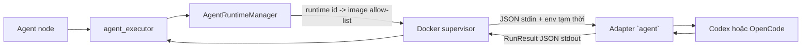
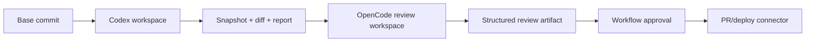

# Tích hợp Codex và OpenCode vào AgentFlow

Ngày cập nhật: **12/10/2026**. Trạng thái: **Codex và OpenCode contract v1 đã được triển khai, có contract test và được nạp vào catalog Compose**.

Tài liệu này mô tả cách đưa Codex, OpenCode và các agent runtime tương tự vào AgentFlow. Mục tiêu là giữ một contract ổn định ở phía workflow, còn mọi khác biệt về CLI, SDK, session, event và permission được xử lý bên trong adapter của từng runtime.

Tài liệu liên quan:

- [Contract và catalog nhiều Agent runtime](agent-runtime-management.md)
- [Thiết kế tích hợp agent tổng quát](agent-integration.md)
- [Vòng đời container dùng một lần](ephemeral-agent-runtime.md)
- [Quy ước thư mục `src/agents`](../src/agents/README.md)

## 1. Kết luận kiến trúc

Không gọi Codex hoặc OpenCode trực tiếp từ workflow worker. Mỗi runtime được đóng gói thành một image riêng và cung cấp executable `agent` theo contract AgentFlow:



Hướng triển khai được chia làm hai mức:

| Mức | Phạm vi | Có thể dùng với hệ thống hiện tại |
| --- | --- | --- |
| Contract v1 — one-shot | Một request, một kết quả JSON, không giữ session, không có approval giữa turn | Có; runtime `default`, `codex` và `opencode` đã được nối vào Compose |
| Contract v2 — coding agent đầy đủ | Workspace, diff/artifact, stream event, session/resume, cancel và approval | Chưa; cần mở rộng supervisor, persistence và API/UI |

Nên triển khai v1 trước cho tác vụ phân tích, lập kế hoạch hoặc review từ context JSON. Không quảng bá khả năng sửa repository cho đến khi AgentFlow mount một workspace cô lập và thu artifact an toàn.

## 2. Hiện trạng đọc từ code

### Đã có

- `src/agents/<runtime-id>` là một đơn vị runtime độc lập, có `runtime.json` và `Dockerfile`.
- `src/agents/manage.py` discover, validate và build runtime.
- `AgentRuntimeManager` đọc allow-list `AGENT_RUNTIME_IMAGES`, resolve `config.runtime` và không cho graph truyền image tùy ý.
- Mỗi invocation chạy image trong container mới bằng executable `agent`.
- Request và response đi qua JSON UTF-8; log runtime phải đi qua `stderr`.
- Supervisor áp dụng user `10001`, root filesystem chỉ đọc, drop capability, `no-new-privileges`, giới hạn CPU/RAM/PID, timeout, output size và network.
- UI cho phép nhập runtime id; `agent` là alias của runtime mặc định và `direct` là đường gọi model trực tiếp trong worker.
- Compose build đồng thời image `default`, `codex` và `opencode`, rồi truyền catalog `AGENT_RUNTIME_IMAGES` cho worker.
- Worker ánh xạ provider đã chọn sang `AGENT_PROVIDER_BASE_URL` và `AGENT_PROVIDER_API_KEY`; mọi runtime mới dùng contract credential này thay vì tự đọc key từ `.env`.
- `src/agents/codex` pin `@openai/codex@0.130.0`, chạy `codex exec --ephemeral`, dùng Responses API và structured output.
- `src/agents/opencode` pin `opencode-ai` và `@opencode-ai/sdk` cùng phiên bản `1.19.0`, chạy server loopback, dùng session prompt structured output, deny tool tích hợp sẵn và chỉ allow MCP đã chọn.

### Chưa có hoặc chưa nối hoàn chỉnh

| Khoảng trống | Ảnh hưởng đến Codex/OpenCode |
| --- | --- |
| Model management hiện chỉ đăng ký provider loại `openrouter` | Runtime nhận credential theo contract chung, nhưng chưa thể chọn provider OpenAI/Anthropic trực tiếp cho đến khi trang Models hỗ trợ thêm provider kind |
| Codex và OpenCode ánh xạ `AGENT_MCP_SERVERS` vào config riêng của runtime | Cả hai hỗ trợ Streamable HTTP, giữ header trong environment và fail run nếu MCP bắt buộc không kết nối được; SSE chỉ có ở runtime mặc định |
| Container không mount repository/workspace | Runtime chỉ có thể xử lý `task` và `context`; chưa thể sửa code thật |
| Root filesystem chỉ đọc, chỉ `/tmp` là tmpfs `noexec` | Runtime phải đặt state tạm, schema và output trong `/tmp`; không được giả định có home ghi được |
| Contract chưa có session, artifact, event, approval hoặc runtime-native cancel | Không thể dùng đầy đủ App Server hoặc OpenCode server qua một lần JSON stdin/stdout |
| Supervisor chỉ kiểm tra `output` là object | Cần validate `output_schema` tập trung; không chỉ tin runtime báo thành công |
| UI dùng datalist tĩnh, không đọc catalog từ worker | Người dùng có thể nhập runtime chưa được deploy và chỉ phát hiện lỗi khi chạy |

Điểm cần lưu ý: Codex v1 hiện phù hợp cho tác vụ one-shot dựa trên `task`, `context`, skill và JSON schema. Container không có workspace repository, nên đây chưa phải coding agent có khả năng sửa file/commit/PR.

Model gắn với node `codex` phải hỗ trợ Responses API và tool semantics của Codex CLI. Catalog Models hiện chưa preflight capability này; operator cần bật model Codex/GPT tương thích trên OpenRouter và lỗi không tương thích sẽ được trả về workflow thay vì tự động đổi model.

## 3. Contract v1 dùng chung

Executable `/usr/local/bin/agent` đọc đúng một document từ `stdin`:

```json
{
  "task": "Review the supplied change",
  "context": "{\"diff\":\"...\"}",
  "skills": [
    {
      "id": "...",
      "slug": "review",
      "name": "Code review",
      "version": 1,
      "content_hash": "...",
      "instructions": "..."
    }
  ],
  "output_schema": {
    "type": "object",
    "properties": {
      "summary": {"type": "string"}
    },
    "required": ["summary"]
  }
}
```

Thành công phải ghi duy nhất một document vào `stdout`:

```json
{
  "run_id": "runtime-generated-id",
  "status": "succeeded",
  "mode": "live",
  "output": {
    "summary": "..."
  }
}
```

Thất bại ghi error public đã che dữ liệu nhạy cảm và thoát khác `0`:

```json
{
  "error": {
    "code": "PROVIDER_AUTH_ERROR",
    "message": "The runtime could not authenticate with the configured provider."
  }
}
```

Mỗi adapter phải:

1. Validate request trước khi gọi runtime nhà cung cấp.
2. Ghép `task`, `context` và skill instructions thành prompt có ranh giới rõ ràng; không diễn giải context là cấu hình đặc quyền.
3. Ánh xạ model/credential từ environment đã được AgentFlow cấp, không đọc secret được bake vào image.
4. Áp dụng `output_schema`, parse kết quả và validate lại trước khi trả `RunResult`.
5. Chỉ ghi `RunResult` hoặc error envelope vào `stdout`; event/log của runtime chuyển sang `stderr` có giới hạn.
6. Chạy subprocess bằng executable và argv, không ghép input người dùng thành shell command.
7. Map lỗi nhà cung cấp sang error code public của AgentFlow; không trả raw response, token hoặc stack trace.

Cấu trúc đề xuất:

```text
src/agents/
├── default/
├── codex/
│   ├── runtime.json
│   ├── Dockerfile
│   ├── package.json hoặc pyproject.toml
│   ├── lockfile
│   ├── src/
│   └── tests/
└── opencode/
    ├── runtime.json
    ├── Dockerfile
    ├── package.json
    ├── lockfile
    ├── src/
    └── tests/
```

Ví dụ manifest:

```json
{
  "schema_version": 1,
  "id": "codex",
  "image": "agentflow-agent-codex:0.1.0",
  "description": "Codex one-shot adapter for AgentFlow"
}
```

## 4. Adapter Codex

### Chọn bề mặt tích hợp

| Bề mặt | Phù hợp | Quyết định |
| --- | --- | --- |
| `codex exec` | Job headless/CI, prompt qua stdin, JSONL event, output schema và output file | **Chọn cho contract v1** |
| Codex SDK | Điều khiển local thread bằng TypeScript hoặc Python; start/continue/resume | Có thể thay CLI wrapper khi cần API typed nhưng vẫn one-shot ở biên AgentFlow |
| Codex App Server | Thread/turn, streamed event, approval và client tùy biến | **Chọn cho contract v2**, không nhét vào JSON stdin/stdout v1 |

Codex CLI hỗ trợ `codex exec`, đọc prompt từ stdin, `--output-schema`, `--output-last-message`, event JSONL và resume session. Codex SDK hỗ trợ start/continue/resume thread. App Server dùng handshake `initialize`/`initialized`, sau đó `thread/start` hoặc `thread/resume`, `turn/start`, streamed notification và server-initiated approval request. Nguồn chính thức: [Codex SDK](https://developers.openai.com/codex/sdk/), [Codex CLI reference](https://developers.openai.com/codex/cli/reference/), [Codex App Server](https://developers.openai.com/codex/app-server/).

### Mapping v1 đã triển khai

Adapter Codex nên thực hiện luồng sau:

1. Đọc và validate `RunRequest`.
2. Ghi `output_schema` vào file ngẫu nhiên dưới `/tmp`.
3. Tạo prompt gồm nhiệm vụ, context không tin cậy, skill instructions và yêu cầu chỉ trả JSON.
4. Parse `AGENT_MCP_SERVERS`; ánh xạ server Streamable HTTP sang `mcp_servers.<slug>`, đặt `required=true`, và đưa header secret qua `env_http_headers` thay vì argv.
5. Chạy `codex exec` với argv cố định, prompt qua stdin, sandbox `read-only` cho use case chưa có workspace, schema và output file dưới `/tmp`.
6. Parse file kết quả; không lấy dòng cuối của log làm kết quả.
7. Validate JSON Schema rồi bọc thành `RunResult`.
8. Xóa auth state/file tạm khi kết thúc; container dùng một lần tiếp tục là ranh giới cleanup cuối.

Không dùng `--dangerously-bypass-approvals-and-sandbox`. Khi AgentFlow có workspace, chuyển sang `workspace-write` chỉ trong checkout riêng của attempt; quyền network và connector vẫn do policy AgentFlow kiểm soát.

### Authentication và model

- Không thực hiện browser login trong container job.
- Codex CLI có headless login bằng API key hoặc access token đọc từ stdin; credential phải được resolve từ secret store cho đúng invocation, đặt trong vùng ghi tạm và không persist sang job khác.
- Không mount thư mục cấu hình Codex cá nhân của host vào container.
- Model từ node phải được adapter kiểm tra với provider/auth mode thực tế; không hard-code một model mặc định vào engine.
- Cần bổ sung credential mapping riêng cho runtime Codex. Chỉ thêm tên env cần thiết vào allow-list của image Codex, không mở passthrough toàn bộ environment của worker.

### Mapping v2 qua App Server

Khi có session và UI tương tác, supervisor giữ các khóa sau trong persistence:

```text
runtime=codex
thread_id
turn_id
job_id
workspace_ref
event_cursor hoặc sequence nội bộ
runtime_version + image_digest
```

Adapter phải hoàn thành handshake trên mỗi connection, lưu `thread_id` trước khi bắt đầu turn khi có thể, chuẩn hóa `turn/completed` thành trạng thái terminal và chuyển approval request thành event bền vững. Quyết định approval phải gắn đúng `thread_id`, `turn_id`, `item_id` và request đang chờ; không replay quyết định cũ cho action khác.

## 5. Adapter OpenCode

### Chọn bề mặt tích hợp

| Bề mặt | Phù hợp | Quyết định |
| --- | --- | --- |
| OpenCode SDK + server cục bộ | Tạo session, prompt có structured output, abort và subscribe SSE | **Chọn cho v1 và là nền cho v2** |
| `opencode serve` + HTTP/OpenAPI | Tách client/server, inspect API và quản lý session từ supervisor | Dùng cho v2 hoặc khi cần adapter độc lập process |
| `opencode run --format json` | PoC CLI, raw event JSON | Chỉ dùng smoke test; SDK rõ hơn cho structured output |

OpenCode SDK có thể start server và client cùng lúc hoặc kết nối server có sẵn. SDK cung cấp session create/prompt/abort, `format` cho structured output và stream event. Server headless công bố OpenAPI, session APIs, SSE và endpoint trả lời permission; HTTP Basic Auth được bật bằng `OPENCODE_SERVER_PASSWORD`. Nguồn chính thức: [OpenCode SDK](https://opencode.ai/docs/sdk/), [OpenCode Server](https://opencode.ai/docs/server/), [OpenCode Permissions](https://opencode.ai/docs/permissions/).

### Mapping v1 đã triển khai

Adapter hiện thực hiện luồng sau:

1. Start OpenCode server trên `127.0.0.1` trong cùng container bằng helper SDK sở hữu cả server và client.
2. Subscribe event trước khi gửi prompt để không mất event đầu.
3. Tạo session trong thư mục làm việc của attempt.
4. Gửi model dưới dạng provider ID + model ID và truyền `output_schema` qua `format: { type: "json_schema" }`.
5. Ánh xạ MCP Streamable HTTP sang remote `mcp`, tắt OAuth tự động, xác nhận mọi server đã chọn có trạng thái `connected`, và chỉ allow tool theo `<server>_*`.
6. Lọc event theo session; dùng event permission để fail closed, giới hạn provider retry và abort trước deadline của supervisor thay vì để request treo vô hạn.
7. Lấy structured result từ response/session state, validate lại schema và trả `RunResult`.
8. Abort session và đóng server trong `finally`, kể cả khi prompt hoặc validation thất bại.

Trong implementation contract v1, permission mặc định là `{"*":"deny"}` và adapter chỉ thêm `"<mcp-slug>_*":"allow"` cho MCP đã chọn. Nếu runtime vẫn phát event xin quyền, adapter abort session và trả `CAPABILITY_UNSUPPORTED` thay vì tự động approve. OpenCode có mặc định khá permissive cho nhiều tool, vì vậy adapter không dựa vào default của phiên bản runtime.

### Authentication và cấu hình

- Sinh config SDK tạm cho invocation từ provider/model đã được AgentFlow cho phép; không đọc config project hoặc home của host.
- Dùng biến môi trường tham chiếu secret; không ghi giá trị API key trực tiếp vào config hoặc log.
- Dùng `enabled_providers` để giới hạn provider trong job khi phù hợp.
- State, auth và config tạm đặt trong filesystem riêng của attempt; không dùng chung `~/.local/share/opencode/auth.json` giữa tenant hoặc container.
- Nếu chạy HTTP server khác process/container, chỉ bind loopback hoặc private runtime network, bật authentication và không expose thẳng cho browser. CORS không thay thế authentication/authorization.

### Mapping v2

Lưu `session_id`, message ID cuối, workspace ref và cursor event của AgentFlow. SSE chỉ là kênh live; sau reconnect phải đọc session status/messages để xác nhận trạng thái thay vì suy ra rằng mất stream nghĩa là job thất bại. Permission request được chuyển thành event bền vững và response chỉ gửi lại khi request vẫn thuộc đúng session/action.

## 6. Credential và provider abstraction

AgentFlow hiện lấy model/API key từ provider đã đăng ký trong Models cho mọi runtime container. Worker xóa credential model có thể tồn tại sẵn trong process environment, giải mã key đúng lúc chạy và inject contract chung:

```dotenv
AGENT_PROVIDER=openrouter
AGENT_MODEL=openai/gpt-5.1-codex
AGENT_PROVIDER_BASE_URL=https://openrouter.ai/api/v1
AGENT_PROVIDER_API_KEY=<decrypted only for this attempt>
```

Các alias `OPENROUTER_*` vẫn được truyền để tương thích runtime `default`; runtime mới phải ưu tiên `AGENT_PROVIDER_*`. Request JSON, workflow snapshot, Docker argv và label không chứa secret.

Registry Models hiện chỉ hỗ trợ provider kind `openrouter`. Khi bổ sung OpenAI, Anthropic hoặc gateway khác, nên tách `RuntimeCredentialResolver` thay vì mở rộng một chuỗi điều kiện theo runtime trong `agent_executor.py`.

Yêu cầu:

- tiếp tục allow-list tên env theo runtime/provider;
- xóa toàn bộ model credential cũ khỏi process environment trước khi inject;
- không đưa secret vào request JSON, workflow version, trace attribute hoặc Docker label;
- ưu tiên token ngắn hạn/proxy có quota khi hạ tầng hỗ trợ;
- snapshot provider kind, model ref và image digest cho audit, nhưng không snapshot secret.

OpenCode có thể nói chuyện với nhiều provider hơn Codex. Điều đó không có nghĩa một model/provider đã đăng ký trong AgentFlow tự động tương thích với cả hai runtime. Mỗi runtime cần capability/preflight riêng.

## 7. Workspace và artifact cho coding task

Contract v1 không có workspace mount. Để Codex/OpenCode sửa code, bổ sung contract v2 tối thiểu:

```json
{
  "contract_version": 2,
  "operation_key": "...",
  "task": "...",
  "context": {},
  "workspace": {
    "path": "/workspace",
    "base_commit": "...",
    "mode": "read-write"
  },
  "output_schema": {},
  "policy": {
    "network_profile": "llm-only",
    "approval_mode": "node-boundary",
    "deadline_at": "..."
  }
}
```

Supervisor, không phải adapter, chuẩn bị checkout/snapshot riêng và mount đúng một workspace vào `/workspace`. Sau turn, supervisor thu diff, test report và file output thành artifact có checksum. Không tin đường dẫn file do model trả về; phải kiểm tra path traversal, symlink, loại file và kích thước.

Chuyển giao Codex sang OpenCode bằng artifact chuẩn hóa:



Không chuyển trực tiếp thread/session nội bộ giữa hai runtime. Session chỉ có ý nghĩa với runtime và phiên bản đã tạo ra nó.

## 8. Catalog và deploy nhiều image

Catalog hiện được Compose truyền cho worker:

```dotenv
AGENT_RUNTIME_DEFAULT=default
AGENT_RUNTIME_IMAGES={"default":"agentflow-agent-default:0.1.0","codex":"agentflow-agent-codex:0.1.0","opencode":"agentflow-agent-opencode:0.1.0"}
```

`workflow-worker` nhận catalog này; các service `agent-runtime-default-image`, `agent-runtime-codex-image` và `agent-runtime-opencode-image` bảo đảm image local được build trước khi worker khởi động.

Quy trình local hiện tại:

```powershell
python src/agents/manage.py validate
python src/agents/manage.py build --all
docker image inspect agentflow-agent-codex:0.1.0
docker image inspect agentflow-agent-opencode:0.1.0
```

Workflow chọn runtime bằng ID, không dùng image reference:

```json
{
  "type": "agent",
  "config": {
    "runtime": "codex",
    "providerId": "provider-uuid",
    "model": "model-id",
    "instructions": "Review {{input.diff}}",
    "outputSchema": {
      "type": "object",
      "properties": {
        "findings": {"type": "array"}
      },
      "required": ["findings"]
    }
  }
}
```

Production phải dùng image digest hoặc tag bất biến do CI build. Worker không build image theo request và graph không được quyền chọn registry/image tùy ý.

## 9. Capability model đề xuất

Thêm capability vào manifest hoặc registry deploy để publish/preflight từ chối sớm cấu hình không phù hợp:

```json
{
  "contract_version": 1,
  "capabilities": {
    "structured_output": true,
    "workspace_read": false,
    "workspace_write": false,
    "streaming": false,
    "session_resume": false,
    "interactive_approval": false,
    "mcp": false
  }
}
```

Không suy đoán capability chỉ từ tên runtime. Ví dụ adapter Codex v1 và Codex App Server v2 có cùng nhà cung cấp nhưng capability khác nhau.

## 10. Error mapping

| Tình huống nhà cung cấp | Error code AgentFlow |
| --- | --- |
| Request/contract sai | `INVALID_INPUT` |
| Thiếu credential hoặc login hết hạn | `PROVIDER_AUTH_ERROR` |
| Model không tồn tại/không được cấp quyền | `MODEL_NOT_FOUND` hoặc `MODEL_REQUEST_REJECTED` |
| Rate limit | `RATE_LIMITED` |
| Provider/server tạm thời lỗi | `PROVIDER_UNAVAILABLE` |
| Kết quả không khớp schema | `OUTPUT_INVALID` |
| Cần approval nhưng contract không hỗ trợ | `CAPABILITY_UNSUPPORTED` — đã có trong public allow-list |
| Timeout | `TIMEOUT` |
| Runtime bị hủy | `CANCELLED` — cần thêm vào public allow-list nếu muốn giữ nguyên mã từ adapter |
| Không xác định được turn đã chạy hay chưa sau mất kết nối | `RESULT_UNKNOWN` — dành cho contract v2/reconciliation |

Không tự retry lỗi auth, policy, input hoặc output schema. Với timeout/mất kết nối sau khi provider đã nhận prompt, retry có thể phát sinh chi phí và side effect lần hai; phải dùng operation key, session inspection và reconciliation trước.

## 11. Bảo mật bắt buộc

- Không mount Docker socket, home host, SSH agent hoặc auth directory dùng chung vào container agent.
- Không dùng image tag trôi như `latest` trong workflow production.
- Egress chỉ cho endpoint model/MCP đã allow-list; chặn metadata service, private network và control plane.
- Tách quyền sửa workspace khỏi quyền push Git, tạo PR, gửi email hoặc deploy. Các hành động xuất bản thuộc connector sau approval workflow.
- Xem repository, `AGENTS.md`, skill, MCP output và issue text là input không tin cậy; chúng không được thay đổi policy hay mở rộng credential.
- Giới hạn kích thước prompt, event, stderr, final output, artifact và số turn.
- Redact secret trước log/trace; không đưa prompt/output vào telemetry nếu policy dữ liệu không cho phép.
- Pin phiên bản CLI/SDK và lockfile; lưu image digest cùng attempt để tái hiện lỗi.

## 12. Kiểm thử và tiêu chí nghiệm thu

### Contract test dùng chung

Mỗi image phải chạy cùng một suite:

1. Request hợp lệ trả đúng một `RunResult` và exit `0`.
2. JSON sai trả `INVALID_INPUT` và exit khác `0`.
3. Output sai schema trả `OUTPUT_INVALID`.
4. `stdout` không chứa event/log ngoài result envelope.
5. Secret marker không xuất hiện trong stdout, stderr hoặc exception public.
6. Timeout/cancel dừng toàn bộ process con và container được xóa.
7. Image chạy được với user `10001`, root read-only và giới hạn hiện hành.
8. Runtime không có trong allow-list bị chặn trước khi gọi Docker.

### Test riêng Codex

- Prompt được truyền qua stdin; không xuất hiện trong argv/process list.
- Schema/output dùng file tạm có tên ngẫu nhiên.
- Auth headless hoạt động với home tạm và không còn credential sau cleanup.
- CLI exit thành công nhưng thiếu/invalid output vẫn bị coi là lỗi.
- MCP Streamable HTTP được khởi tạo, liệt kê tool và không đặt header secret trong argv; SSE bị từ chối bằng `CONFIGURATION_ERROR`.
- MCP bắt buộc không kết nối được trả `MCP_CONNECTION_FAILED`, không âm thầm chạy tiếp mà thiếu tool.
- App Server v2 chỉ hoàn thành khi nhận terminal event có status thành công.

### Test riêng OpenCode

- Server chỉ bind loopback trong container v1.
- Subscribe event trước prompt; event từ session khác bị bỏ qua.
- Permission `ask` không bị auto-approve khi AgentFlow chưa hỗ trợ approval.
- MCP Streamable HTTP được cấu hình bằng remote `mcp`; header secret chỉ xuất hiện trong environment tạm và SSE bị từ chối.
- Trạng thái MCP được kiểm tra trước khi tạo session; server không `connected` trả `MCP_CONNECTION_FAILED`.
- `session.abort` và server close luôn chạy trong cleanup.
- Reconnect v2 dùng session state để xác nhận kết quả, không chỉ dựa vào SSE.

### E2E có model thật

Không chạy trong mọi CI. Dùng job opt-in, repository fixture nhỏ, budget thấp và secret riêng. Ghi lại runtime version, image digest, provider/model, duration, token usage nếu có và checksum output; không lưu credential hoặc raw prompt nhạy cảm.

## 13. Thứ tự triển khai đề xuất

1. Hoàn tất: thêm `src/agents/codex`, contract v1, contract test và image pin phiên bản.
2. Hoàn tất: thêm credential trung lập lấy từ Models và nối catalog nhiều image vào Compose.
3. Hoàn tất: ánh xạ MCP Streamable HTTP và header theo environment vào runtime Codex.
4. Tiếp theo: thêm JSON Schema validation tập trung cho output của mọi Agent runtime.
5. Mở rộng runtime manifest/capability và API catalog để UI chỉ hiển thị runtime đã deploy.
6. Mở rộng Models nếu cần provider kind ngoài OpenRouter.
7. Hoàn tất: thêm `src/agents/opencode` theo SDK/server local, policy deny-by-default, MCP Streamable HTTP, JSON Schema validation và contract test.
8. Chạy E2E Codex tool-call có model tương thích, quota ổn định và secret/budget riêng của môi trường thử nghiệm.
9. Thiết kế/migrate contract v2, workspace/artifact store và durable agent job.
10. Thêm event/session/cancel/approval cho Codex App Server và OpenCode server.
11. Chỉ sau đó bật coding task có workspace write và luồng tạo PR qua connector.

Codex và OpenCode v1 hiện có thể được chọn cùng runtime mặc định trong một deployment. OpenCode nhận cùng contract, trả output đã validate, hỗ trợ remote MCP Streamable HTTP và giữ nguyên isolation hiện tại. Điều kiện hoàn thành v2 là job có thể phục hồi sau worker/runtime disconnect, mọi side effect được audit/approval đúng action, và workspace/artifact không bị chia sẻ giữa các attempt.

## 14. Checklist thêm một runtime khác

Codex và OpenCode chỉ là hai implementation. Một runtime mới được chấp nhận khi trả lời được các câu hỏi sau:

- Bề mặt headless chính thức là CLI, SDK hay server protocol?
- Có structured output thật hay adapter phải validate/retry?
- Credential headless được cấp và thu hồi thế nào?
- Runtime cần filesystem ghi ở đâu và có chạy non-root/read-only được không?
- Có workspace root rõ ràng và chặn truy cập path bên ngoài không?
- Cơ chế timeout, cancel và dọn process con là gì?
- Có session ID bền vững, inspect state và resume sau restart không?
- Event có cursor/replay hay chỉ là stream dễ mất?
- Approval request định danh action ra sao và có thể bị stale khi reconnect không?
- Usage/token/cost có nguồn đáng tin cậy hay phải ghi `unknown`?
- Version protocol/SDK/image nào đã được kiểm chứng và khóa?

Nếu runtime không đáp ứng một capability, khai báo `false` và từ chối workflow yêu cầu capability đó. Không giả lập resume, approval hoặc structured output bằng cách coi text tự do là trạng thái thành công.
