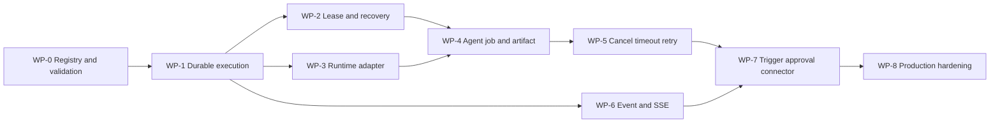

# Plan to add workflow core and Agent Runtime

Date of creation: **October 3, 2026**. Status: **under implementation**.

This document converts the current PoC gaps into a work order that can be implemented and accepted. It does not replace detailed design documents:

- [Workflow specification](workflow-spec.md)
- [Workflow storage and execution](workflow-execution.md)
- [Parallel workflow execution](parallel-workflow-execution.md)
- [Disposable Agent runtime](ephemeral-agent-runtime.md)
- [event-driven design](event-driven.md)

## 1. Goal

After completing the required milestones, AgentFlow must ensure:

1. A persistently received run is not lost when the API, worker or runner restarts.
2. Redis redelivery does not silently rerun the same agent attempt or side effect.
3. Each Agent node chooses a runtime with clear contract, capability and version.
4. Run can be canceled; Deadlines and retries are not reset when the worker restarts.
5. Workspace, result and necessary artifacts persist after the container is deleted.
6. Invalid Workflow is rejected when published, instead of just an error when the worker runs.
7. UI can monitor progress and recover from lost connection.

## 2. Scope and priority

### P0 — conditions for running the agent safely

- Persistent node attempt, operation key and state machine.
- Lease, heartbeat, fencing and recovery step by step.
- Runtime adapter/registry and capability validation.
- Deadline, cancellation and retry policy.
- Minimal Result manifest, workspace snapshot and artifact store.

### P1 — workflow that can be used in practice

- Node registry is shared by validator, engine and UI.
- HTTP/Webhook, Approval and the first connector.
- Run events, SSE reconnect and log/artifact API.
- Full JSON Schema validator.

### P2 — production operations

- Quota and backpressure by owner/provider/runtime.
- Usage/cost, OpenTelemetry, metrics and alerts.
- The Runner separates from the Docker socket of the worker workflow.
- Project RBAC, retention, backup/restore and extended audit.

Do not deploy Map, loop, subflow, marketplace or collaborative editing before P0 is complete.

## 3. Required invariants

Changes below must keep the following invariants:

- `workflow_versions.graph` is an immutable snapshot of the execution configuration.
- Each logical node execution has a stable `operation_key` via redelivery.
- Retry actively creates new `attempt`; redelivery with attempt does not create a new job/container.
- Only the lease owner with exactly `lease_generation` can commit the heartbeat or results.
- Results and artifact manifest are committed before the temporary container/workspace is deleted.
- Run terminal cannot return to `running` because the event is late.
- Cancel intent is committed before sending the stop signal to the runner.
- External side effects cannot be retried if the result state is ambiguous.
- Secret does not appear in the default graph snapshot, command payload, event, argv or log.

## 4. Deployment order



WP-0 should do it first because currently the validator can accept nodes that the engine does not support. WP-1 to WP-5 is the critical path before adding a Codex/OpenCode runtime or connector with side effects.

### Execution status

| Work packages | Status | Notes |
| --- | --- | --- |
| WP-0 | Completed the first slice on October 3, 2026 | Registry server-side, API `/v1/node-types`, version pinning on publish, validation node/version/binding and editor/planner using execution catalog |
| WP-1 | Ongoing | Added background schema/migration for `node_attempts`, `run_commands`, `run_events`; worker dual-write and recovery belongs to the next PR |
| WP-2 to WP-8 | Not started yet | Follow the dependency above |

## 5. Work package details

### WP-0 — Unified node registry and validation

**Required results**

- A server-side registry defined for each node:
  - `type`, `typeVersion`;
  - config/input/output JSON Schema;
  - control ports;
  - executor key;
  - side-effect class;
  - capabilities and credential requirements.
- Validator rejects empty graph, unsupported node, unsupported version, wrong binding and wrong port.
- Agent planner can only recommend nodes that are in the execution catalog.
- UI gets metadata from API or generated schema instead of maintaining independent list.

**Recommended API**

```text
GET /v1/node-types
```

**Acceptance criteria**

- Publish graph with `http.request` when unregistered executor must pay `422`.
- Publish an empty graph or a binding to an output that does not exist must return `422`.
- All published workflows can be received by the engine without the `unsupported node type` error.
- Contract test compares node catalog of API, editor and agent planner.

### WP-1 — Durable execution ledger

Keep `run_steps` as the execution projection node in the first stage and add the following tables.

#### `node_attempts`

| School | Request |
| --- | --- |
| `id`, `run_step_id`, `attempt` | Unique by `(run_step_id, attempt)` |
| `operation_key` | Unique, stable for one attempt |
| `status` | `queued`, `running`, `succeeded`, `failed`, `timed_out`, `cancelled`, `unknown` |
| `input_hash`, `config_hash` | Check provenance |
| `error_code`, `error` | Normalized error, does not contain secret |
| `started_at`, `completed_at`, `deadline_at` | Absolute deadline |
| `result_ref`, `usage` | Reference to manifest and usage |

#### `run_commands`

| School | Request |
| --- | --- |
| `id`, `run_id`, `type` | `start`, `cancel`, `approval_decision` |
| `idempotency_key`, `payload_hash` | Unique by owner/scope |
| `status` | `accepted`, `applied`, `rejected` |
| `created_at`, `applied_at` | Audit command |

#### `run_events`

| School | Request |
| --- | --- |
| `id`, `run_id`, `sequence` | Sequence increases monotonically with run |
| `type`, `payload` | Lifecycle payload is small, sensitive data is masked |
| `created_at` | Used for retention and SSE replay |

**Change worker**

- Do not rebuild all steps in state `pending` when reclaiming run.
- Load terminal steps/attempts and only schedule steps that have not been completed.
- Commit step transition and `run_event` in the same transaction.
- Use compare-and-set to prevent terminal state from being overwritten.

**Acceptance criteria**

- Crash after a node succeeds does not cause that node to run again.
- If two workers receive the same run, only one worker is allowed to create an attempt.
- Late event does not change run `succeeded` to `running`.

### WP-2 — Lease, heartbeat, fencing and reconciliation

Add time-limited ownership to execution workflow and agent job:

```text
lease_owner
lease_expires_at
lease_generation
heartbeat_at
```

**Rules**

- Claim increases to `lease_generation` in transaction.
- All updates after the claim must have the condition `lease_generation = expected`.
- Workers renew leases while running long nodes.
- Redis `XAUTOCLAIM` only transfers permission to read messages; The new database lease decides write permissions.
- Reconciler checks run/job lease ends and switches to `unknown`, resume or retry according to policy.

**Acceptance criteria**

- Old workers cannot record results after losing lease.
- Agents running longer than `WORKFLOW_RECLAIM_IDLE_MS` do not create a second execution.
- Killing workers before/after each commit boundary gives definite results.

### WP-3 — Agent Runtime Adapter contract

Create interface independent of Docker and specific provider:

```python
class AgentRuntimeAdapter(Protocol):
    runtime_type: str
    contract_version: str

    async def capabilities(self) -> RuntimeCapabilities: ...
    async def start(self, request: AgentJobRequest) -> AgentJobHandle: ...
    async def inspect(self, handle: AgentJobHandle) -> AgentJobState: ...
    async def cancel(self, handle: AgentJobHandle) -> None: ...
    async def collect(self, handle: AgentJobHandle) -> AgentResultManifest: ...
```

Minimum `RuntimeCapabilities` includes:

- `tools`, `mcp`, `shell`, `workspace_write`;
- `session_resume`, `streaming`, `interactive_approval`;
- input/output types and artifact support;
- network/resource profiles are allowed.

Minimum `AgentJobRequest` includes:

- `job_id`, `operation_key`, `contract_version`;
- task/context and output schema;
- runtime type, image digest/version;
- workspace/artifact references;
- deadline and resource/network policy;
- references to authorized credentials.

Minimum `AgentResultManifest` includes:

- `job_id`, `operation_key`, status and error code;
- structured output reference/checksum;
- artifact references/checksums;
- usage, runtime version and timestamps.

**First adapter**

1. Wrap the current Deep Agents runtime into `deepagents-container-v1`.
2. Keep `direct` as LLM node compatibility path, not considered full agent runtime.
3. Only add Codex/OpenCode after the first adapter's contract test passes.

**Acceptance criteria**

- Publish fails if the node requesting the runtime capability is not available.
- Workflow version snapshot runtime type, contract version and image digest.
- Changing the default image tag does not change the runtime of the old version.
- Each adapter runs the same set of contract tests.

### WP-4 — Agent job, workspace and artifact

Add `agent_jobs` and `artifacts`; The agent job must go through a separate queue instead of the workflow worker holding the Docker process during execution.

#### `agent_jobs`

- FK to `node_attempts` and unique `operation_key`.
- Runtime type, contract version, image digest.
- State, runner, lease and internal container reference.
- Result reference, termination reason and cleanup state.

#### `artifacts`

- Owner/run/step/attempt scope.
- Object key, content type, size, checksum.
- Kind: `result`, `log`, `diff`, `workspace_snapshot`, `report`.
- Retention, created time and immutable/finalized state.

**MVP storage**

- Define `ArtifactStore` interface.
- There is a local-volume implementation for development.
- Do not write the host path directly into the public contract.
- Apply size limit and checksum before finalizing.

**Acceptance criteria**

- Runner dies after uploading result but before terminal commit can reconcile manifest without calling model again.
- The container is deleted but the finalized output/diff/log can still be loaded according to the ACL.
- Two attempts do not share the same writable workspace.
- Artifact wrong checksum cannot be used as output node.

### WP-5 — Deadline, cancellation and retry policy

**Recommended API**

```text
POST /v1/runs/{runId}/cancel
GET  /v1/commands/{commandId}
```

Status change request must receive `Idempotency-Key`.

**Minimum retry policy**

```json
{
  "maxAttempts": 3,
  "initialBackoffSeconds": 2,
  "maxBackoffSeconds": 30,
  "retryableCodes": ["PROVIDER_OVERLOADED", "RATE_LIMITED", "PROVIDER_UNAVAILABLE"]
}
```

**Rules**

- Deadline is the absolute timestamp that is snapshotted when creating a run/attempt.
- Retry does not reset deadline or budget.
- Auth, schema, policy and invalid input do not retry automatically.
- Side effect timeout results in unknown `reconciliation_required` transfer.
- Cancel stops scheduling the new node, cancels the running job, waits for cleanup and then terminal.

**Acceptance criteria**

- Send cancel twice returning the same command/result.
- Cancel the running container to stop the process tree and cleanup resources.
- Provider 429 retries the correct number of times and keeps the same logical execution.
- Worker restart during backoff does not lose the retry schedule.

### WP-6 — Event stream, log and run viewer

**Recommended API**

```text
GET /v1/runs/{runId}/events
GET /v1/runs/{runId}/stream
GET /v1/artifacts/{artifactId}/download
```

SSE supports `Last-Event-ID`; If the cursor runs out of retention, the server requests the client to redownload the snapshot. Do not include each token in the database event log; Delta tokens can use short-term and limited channels.

**Acceptance criteria**

- Reload UI re-displays the full lifecycle from the projection.
- Losing SSE connection and then reconnecting does not miss the lifecycle event.
- Other users cannot read event/log/artifact even though they know the UUID.

### WP-7 — Trigger, Approval and first connector

Deploy in order:

1. HTTP Request is read-only, has timeout and response size limit.
2. Webhook trigger has signature/timestamp validation and delivery dedup.
3. Approval node has action hash, reviewer scope and expiry.
4. An external-write connector, recommended GitHub draft pull request.

**Recommended API**

```text
POST /v1/webhooks/{triggerId}
POST /v1/approvals/{requestId}/decisions
```

**Acceptance criteria**

- With webhook delivery ID, create only one logical run.
- Two approval decisions at the same time, only one is applied.
- Artifact/action hash changes make the old approval invalid.
- Connector timeout after request must be reconciled before retry.
- Deny or expiry does not create side effects.

### WP-8 — Production hardening

- Separate Agent Runner Supervisor from workflow worker.
- Do not mount Docker socket to the worker handling orchestration.
- Egress allowlist/proxy; Block metadata and control-plane network.
- Short-term secret or broker/proxy instead of long-term API key in the container.
- Quotas for backlog, concurrent jobs, CPU/RAM/PID/disk/output by owner/runtime/provider.
- OpenTelemetry trace; metric queue age, lease age, attempt, retry, cleanup, token/cost.
- Backup/restore database and artifact metadata/data.
- Retention and deletion of data covering the database, artifacts, logs and runtime sessions.

## 6. Recommended run and step status

### Run

```text
pending -> running -> waiting_approval -> running
   |          |              |
   +----------+--------------+-> cancelling -> cancelled
   +----------+--------------+-> failed
   +----------+--------------+-> timed_out
   `---------------------------> succeeded
```

### Step/attempt

```text
pending -> queued -> running -> succeeded
                     |  |  |
                     |  |  +-> failed
                     |  +----> timed_out
                     +-------> cancelled
                     `-------> unknown -> reconciliation_required
```

Each transition must have a valid compare-and-set; Do not update with free status string.

## 7. Migration strategy

1. Add a new table/column without changing the current path.
2. Dual-write `run_steps` and `run_events` under feature flag.
3. Move the Agent node to `agent_jobs` with the Deep Agents adapter.
4. Enable lease/fencing and recovery for a canary worker.
5. Turn on cancel/retry and SSE.
6. Remove the container run directly from the workflow worker after fault-injection is reached.

Recommended feature flags:

```dotenv
DURABLE_NODE_ATTEMPTS_ENABLED=false
AGENT_JOB_RUNNER_ENABLED=false
RUN_EVENTS_ENABLED=false
SSE_ENABLED=false
```

Do not keep two orchestrators with the right to decide downstream nodes at the same time. Feature flag only selects implementation; Each run must be pinned into an execution mode upon creation.

## 8. Mandatory testing

### Unit and contract

- Node registry/graph/schema validation.
- Runtime adapter contract for success, invalid output, timeout and cancel.
- State transition and retry classification.
- Operation key and payload hash are stable.

### Integration

- Real PostgreSQL for claim/lease/fencing and concurrent approval.
- Real Redis for duplicate delivery, pending reclaim and stream restart.
- Real Docker for timeout, cancel, OOM, cleanup and orphan reconciliation.
- Real Artifact store for finalize/checksum/ACL.

### Fault injection

Kill process at these points:

1. After DB commit, before enqueue.
2. After enqueue, before ACK outbox.
3. After claim, before start container.
4. After starting the container, first save the container reference.
5. After result upload, before terminal commit.
6. After terminal commit, before queue ACK and cleanup.

Do not close P0 if you have not proven that the above points do not eliminate tremor or double the side effect.

## 9. Definition of Done for MVP core

The MVP core is complete when all of the following conditions are true:

- Redelivery with the same operation key does not create a second attempt/container.
- Worker or runner restart can resume/reconcile from persistent data.
- Cancel and deadline work via restart.
- Runtime is pinned by type, contract version and image digest.
- Agent results, logs and artifacts exist independently of the container.
- Validator rejects any node/config/binding that the engine does not support.
- UI can reconnect and read run history according to ACL.
- There is integration testing and fault-injection for the main execution path.
- Coding agent does not have direct external-write credentials; side effects passing through the controlled connector.

## 10. Proposed starting backlog

The first pull requests should be small and in order:

1. **PR-1 — deployed in working tree:** node registry server-side; Reject empty graphs and unsupported nodes.
2. **PR-2 — deployed in working tree:** migration `node_attempts`, `run_commands`, `run_events` and state enums.
3. **PR-3:** operation key, transactional transitions and event projection.
4. **PR-4:** lease generation, heartbeat and worker recovery from saved step.
5. **PR-5:** runtime adapter contract and adapter `deepagents-container-v1`.
6. **PR-6:** `agent_jobs`, private queue and local supervisor runner.
7. **PR-7:** artifact store local, result manifest and reconciliation.
8. **PR-8:** cancel/deadline/retry policy.
9. **PR-9:** SSE/event replay and update run viewer.
10. **PR-10:** first webhook, approval and connector.

Each PR must include appropriate migration rollback, test failure path, and updated relevant contract documents.
