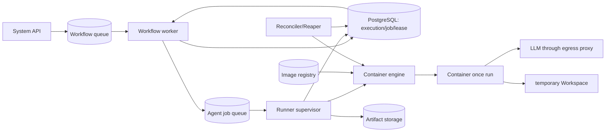
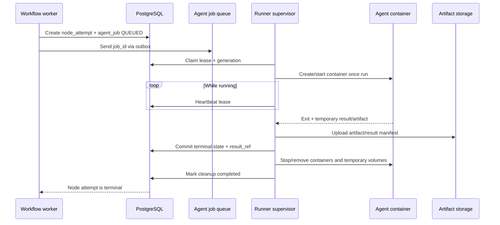

# Disposable Agent runtime design for each node attempt

Update date: **October 3, 2026**. Status: **deployed M0b slice using default agent in `src/agents/default` on Docker local; Custom runtime can be located at `src/agents/<runtime-name>`; Do not use Codex in the current run; Sustainable job/lease/reconciler remains in the next stages**. Scope: node `agent`; Node `llm.call` simply continues to call the provider directly if no tool, shell or workspace is needed.

## 1. Architectural decisions

Each execution of an agent node **attempt** will run in a new container from the digest-locked agent image. The container only receives one request, returns one result, then is stopped and deleted. Retry creates new attempts and containers; Do not reuse the process, graph state, recorded filesystem, or client model of a previous attempt.

Containers are temporary executable resources, not persistent sources of state. Job, lease status, results, logs to keep, and artifacts must be saved outside the container before deletion.

This decision replaces the production route using a persistent HTTP agent service. The HTTP server in `src/agents/default` can be kept for contract development and testing, but the workflow worker does not call it in the new production pipeline.

### Why use an “attempt” as the execution unit?

- An execution node can be retried; Each attempt needs a clean environment and its own identification.
- The same workflow can have multiple agent nodes running in parallel without sharing memory or a writable filesystem.
- Damaged or lost containers do not cause the commit state to be lost.
- Can measure CPU, RAM, time and cost per attempt.
- Can increase the number of runners horizontally without changing the workflow engine contract.

This is not a promise that millions of nodes will run simultaneously with constant latency. The system has finite capacity and depends on the database, Redis, image registry, bandwidth, artifact storage and LLM provider limitations. The correct goal is: get a sustained load, limit the queue, create clear backpressure and increase throughput nearly linearly when adding runners within the remaining bottlenecks.

## 2. Current status and gaps to be filled

The Repository currently has two execution routes for the Agent node:

1. `agent` is the default runtime alias, create `agentflow-agent-*` container from image allow-list in The stack currently registers `default`, `codex`, `opencode` and `openhands`.
2. `direct` calls the LLM provider directly in workflow-worker as the compatible path.

The local slice now lets the workflow-worker call the Docker Engine directly and always cleanup in `finally`. This is not the target production model: still needs an independent **Agent Runner Supervisor**, a persistent job/attempt, and a reconciler so that the workflow-worker does not take hold of the Docker socket.

## 3. Target architecture



Responsibility:

| Ingredients | Responsibility |
| --- | --- |
| Workflow workers | Decide which node is run; create `node_attempt` and agent job; waiting for sustainable results; don't call Docker |
| Agent job queue | `job_id` distribution, at-least-once; Large payloads are only transmitted by reference |
| Runner supervisor | Claim lease, check quota, create/stop/delete containers, heartbeat, collect results and artifact |
| Container agents | Correct execution of a request; do not accept a second job; Do not automatically write database control plane |
| Reconciler/Reaper | Detect expired leases, orphaned jobs/containers, complete idempotent cleanup |
| PostgreSQL | Authoritative job/attempt status source |
| Artifact storage | Save large output, log, diff, test report and immutable result manifest |

Only trusted supervisors can access Docker Engine or the container runtime. APIs, workflow-workers, and container agents cannot mount Docker sockets.

## 4. One-shot execution contract

MVP inherits CLI's JSON contract in `src/agents/default`; Custom runtime must comply with [general contract](../src/agents/README.md). You can then add a mode to read the request and write the result through the mounted file so that the supervisor can control the size and capture the artifact. There is no need to open ports or health endpoints for containers that only run one job.

Logical command:

```text
agent-runtime run --request /run/input/request.json --result /run/output/result.json
```

Supervisor mount private areas:

- `/run/input`: read only, contains resolved requests or references.
- `/run/output`: writable, has quota, only used for result manifest and temporary artifacts.
- `/workspace`: depends on the agent type, is the attempt's own volume/snapshot.
- Root filesystem: read only; `/tmp` is a limited `tmpfs`.

Do not transmit prompt, token or secret on the command line. Do not write the secret to the label, stdout, image layer or result manifest.

### Request envelope

```json
{
  "contractVersion": "1",
  "jobId": "0195...",
  "runId": "0195...",
  "nodeExecutionId": "0195...",
  "attempt": 1,
  "operationKey": "sha256:...",
  "deadlineAt": "2026-09-20T10:30:00Z",
  "runtime": {
    "image": "registry/agentflow-agent@sha256:...",
    "kind": "deep-agent",
    "version": "0.2.0"
  },
  "input": { "task": "...", "context": "..." },
  "skills": [{ "id": "...", "version": 3, "contentHash": "...", "instructions": "..." }],
  "policy": {
    "networkProfile": "llm-only",
    "workspaceMode": "none",
    "maxOutputBytes": 1048576
  },
  "trace": { "traceparent": "..." }
}
```

Potentially large fields such as workspace snapshots or input files must use `artifactRef` with checksum, not stuffing into message queue. `operationKey` is created from node execution, attempt and input/config snapshot; Requests for duplicate keys must be paid with `job_id`, no additional containers will be created.

### Result envelope

```json
{
  "contractVersion": "1",
  "jobId": "0195...",
  "status": "succeeded",
  "output": { "summary": "..." },
  "artifacts": [
    { "name": "result.json", "mediaType": "application/json", "sha256": "...", "size": 1234 }
  ],
  "usage": { "inputTokens": 100, "outputTokens": 40 },
  "runtime": { "version": "0.2.0" }
}
```

Supervisor does not believe the content declared by the container. It must check the schema,

Process convention:

| Results | Exit code | Request |
| --- | ---: | --- |
| Success | `0` | There is a valid and correct result `jobId` |
| Runtime/provider error | `1` | There is an error envelope that has covered sensitive data |
| Input/contract is wrong | `2` | No automatic retry |
| Process killed/OOM/timeout | determined by supervisor | Don't believe the output is unfinished |

Exit code `0` but missing/wrong result is still `RESULT_INVALID`. Having a result file does not mean the job is successful if the process has not ended properly.

## 5. Job lifecycle and commit order



Required order:

1. Commit attempt/job and outbox before enqueue.
2. Runner claims by lease with `generation`; Every subsequent recording must include generation for the old fence runner.
3. Write `container_ref` right after create so the reconciler can find and clean up.
4. Collect and upload the result manifest before recording `SUCCEEDED`.
5. Commit the terminal state before deleting the container.
6. Cleanup always runs in `finally`; If it fails, hold terminal result and pass `cleanup_status=REQUIRED` to the reaper to process.

Do not keep the transaction database open while pulling images, running models, or uploading artifacts.

### State machine proposal

Execution state and cleanup state are separated:

```text
QUEUED -> LEASED -> PROVISIONING -> RUNNING -> COLLECTING
                                      |            |
                                      +------------+-> SUCCEEDED
                                      +------------+-> FAILED
                                      +------------+-> TIMED_OUT
                                      +------------+-> CANCELLED

cleanup_status: NOT_STARTED -> REQUIRED -> RUNNING -> CLEANED
                                             `-----> RETRY_REQUIRED
```

A deleted container should not be used as the sole signal that a job is complete. Status `UNKNOWN` or `LOST` needs to be checked; Do not retry an agent with a side effect without proving that the previous attempt did not have an impact.

### Sessions and approvals

- Do not save sessions that need to be resumed only in the container's filesystem. The session ID, checkpoint, or snapshot must be written to the persistent store before the container terminates, and only the runtime declaring the corresponding capability can be resumed in the new container.
- MVP prioritizes approval at node boundaries: agent creates output/artifact, container closes, then workflow waits for approval. Waiting for approval for many hours or days does not keep the container alive.
- Permission requests between turns are only supported when there are short deadlines, sustainable events and proven resume/reattach mechanisms. If not present, the runtime returns `CAPABILITY_UNSUPPORTED` instead of suspending the container indefinitely or granting permissions itself.
- The next prompt after approval is a new attempt/turn according to the snapshotted contract; Does not rely on the old container's memory process.

## 6. Additional required data

### `node_attempts`

| School | Meaning |
| --- | --- |
| `id`, `node_execution_id`, `attempt` | Identifier; unique by execution + attempt |
| `operation_key` | Immutable idempotency key |
| `status`, `error_code`, `error_metadata` | Normalization results |
| `input_hash`, `config_hash`, `runtime_image_digest` | Provenance of the run |
| `started_at`, `completed_at`, `deadline_at` | Deadline and time measurement |
| `result_ref`, `usage` | Manifest and usage verified |

### `agent_jobs`

| School | Meaning |
| --- | --- |
| `id`, `attempt_id`, `operation_key` | One job per attempt; `operation_key` unique |
| `status` | State machine provisioning/execution |
| `runner_id`, `lease_expires_at`, `lease_generation` | Ownership and fencing |
| `container_runtime`, `container_ref` | Internal reference to inspect/cleanup |
| `heartbeat_at`, `exit_code`, `termination_reason` | Diagnosis |
| `cleanup_status`, `cleanup_attempts`, `cleaned_at` | Monitor independent resource cleanup |
| `result_ref`, `created_at`, `updated_at` | Results and audit |

There should be an append-only `agent_job_events` for transition/audit and an `artifacts` table like the existing design. Do not save container ID like public API; it is the runner's detail.

## 7. Concurrency, backpressure and expansion

Do not create containers within the workflow queue reading loop. Agent jobs go through a separate queue so the workflow-worker is not blocked and the runner can scale independently.

Each runner announces their abilities and only claims when they have enough resources. Use weighted limits instead of just counting containers, for example a job requests `cpu=2`, `memory=4 GiB`, `pids=256`. Minimum limits:

- Whole cluster and by runner.
- According to tenant/project to avoid one user taking up all the resources.
- According to runtime/image and network profile.
- Follow LLM provider/model to respect rate limit.
- Number of jobs being provisioned to avoid image pull/container create clogging the host.

When you run out of capacity, the job is at `QUEUED`; The API can still receive up to the backlog quota. When backlog or timeout exceeds a threshold, return quota/rate limit errors explicitly instead of continuing to receive indefinitely.

Initial estimate using Little's Law:

```text
The required concurrency is approximately arrival_rate × average runtime
```

For example, 10 jobs/second with an average time of 120 seconds requires about 1,200 slots to run, not counting bursts, retries and headroom. Before declaring the scale of millions of nodes, you must separately benchmark queue admission, container start, registry pull, artifact upload, database write rate and provider quota.

Scale direction:

1. Pre-pull image according to digest on runner; Do not pull the same image multiple times at the same time.
2. Small image, version lock dependency; Do not build images for each job.
3. Many independent runners in the same consumer group; Scheduler prioritizes data locality when there is a large workspace.
4. Autoscale according to queue age and resource demand, not just queue length.
5. Have headroom and rate limit for cleanup/reconciliation to avoid “retry storm”.

MVP does not use a warm container pool because it breaks the assumption that each attempt has a new environment. You can evaluate snapshots/VMs or pre-created sandboxes after benchmarking and still ensure that writable state is not reused.

## 8. Required isolation and security

Default container profile:

- Run non-root with fixed UID/GID; not privileged.
- `read_only` root filesystem, `no-new-privileges`, drop all Linux capabilities.
- Limit CPU, memory, PID, time, workspace/output capacity and file size.
- Seccomp/AppArmor/SELinux according to environment; consider gVisor or microVM for untrusted code.
- Do not mount Docker socket, home host, credential control plane or shared volume with write access.
- Default network `none`. Job requires LLM using egress proxy/allowlist; block metadata service, private network and control-plane endpoints.
- Credential is short-term, in the right scope, issued at the trusted edge; Prioritize proxies so containers don't keep long-term API keys.
- Workspace by attempt; Absolutely do not let two containers record the same workspace.
- Log is limited in speed/size and secreted before saving.

Mounting a Docker socket to an equivalent container supervisor grants great authority to the host. Local Compose is acceptable with a risk note; production should run a supervisor as a hardened host service or use an API scheduler/container runtime with clear authentication and policies.

Agents cannot push Git, create PRs, send emails or deploy just because they have a shell. These side effects belong to the connector behind a separate approval/idempotency boundary.

## 9. Timeout, cancel, retry and shutdown

- Deadline taken from database; runner calculates remaining time, does not reset timeout after retry delivery.
- Cancel transfers the intent to the database first, then the supervisor sends `SIGTERM`, waits for a short grace period, then `SIGKILL`; Finally, delete both the container and the temporary volume/network.
- Supervisor lost heartbeat: reconciler inspect container. If the container is still running but the lease has changed generation, fence/stop it before granting a new attempt.
- Retrying infrastructure errors temporarily creates new attempts according to policy. Input, policy, auth and output schema errors are not retried automatically.
- Provider timeout after the request has been sent may still incur costs. Record usage `unknown` if you cannot confirm, do not record `0`.
- When runner shutdown is controlled: stop claiming, mark draining, wait for job in grace period then checkpoint/terminate according to contract; Do not ACK job before terminal commit.

Additional error codes: `IMAGE_UNAVAILABLE`, `PROVISION_FAILED`, `CONTAINER_OOM`, `CONTAINER_EXITED`, `RESULT_INVALID`, `ARTIFACT_UPLOAD_FAILED`, `LEASE_LOST`, `CLEANUP_FAILED`, `RUNNER_LOST`.

## 10. Reconciler and cleanup of orphaned containers

Every container created by AgentFlow must have a label that does not contain a secret:

```text
io.agentflow.managed=true
io.agentflow.job-id=<uuid>
io.agentflow.runner-id=<id>
io.agentflow.lease-generation=<number>
io.agentflow.created-at=<timestamp>
```

Reconciler runs when the supervisor starts and periodically:

1. List containers with `io.agentflow.managed=true` in the runner scope.
2. Compare `job-id`, lease generation and database status.
3. Stop/delete containers without jobs, jobs that have been terminated, leased incorrectly, or expired.
4. Return jobs without containers and lease ends to control status; only requeue when the retry policy allows it.
5. Clean temporary volume/network by label and TTL; Do not delete resources that do not have a management label.

Cleanup must be idempotent: “container does not exist” is considered cleaned up. The uploaded result/artifact is not deleted with the container; Their retention is managed separately by data policy.

## 11. Observability and initial SLO

Metric does not use `job_id` as a label:

- `agent_jobs_queued`, `agent_jobs_running`, `agent_queue_age_seconds`.
- `agent_container_start_seconds`, `agent_job_duration_seconds`.
- `agent_job_total{status,error_code,runtime}`.
- CPU/memory/OOM/exit reason according to runner and runtime.
- `agent_cleanup_pending`, `agent_orphan_containers`, `agent_lease_expired_total`.
- Image pull duration/error, artifact upload duration/error, provider rate-limit.

Log/trace must link `run_id`, `node_execution_id`, `attempt_id`, `job_id`, `runner_id` in a structured field. Prompt and tool output are only saved when the policy allows it.

Proposed PoC goals:

| Index | Goal |
| --- | --- |
| Job is received sustainably | API/workflow worker commit before successful return |
| Container starts with pre-pull image | p95 under 2 seconds on published benchmark configuration |
| Detect runner losing heartbeat | under 60 seconds |
| Cleanup after terminal | p99 under 60 seconds; no more containers after TTL reaper |
| Isolation | Do not share writable filesystem/process state between two attempts |
| Overload | Queue/backpressure is limited; does not crash the control plane |

Numbers must be adjusted after benchmarking, not considered production SLA.

## 12. Proposed configuration

```dotenv
AGENT_EXECUTION_MODE=ephemeral-container
AGENT_JOB_QUEUE_STREAM=agentflow:agent-jobs
AGENT_JOB_QUEUE_GROUP=agent-runners
AGENT_RUNTIME_IMAGE=agentflow-agent@sha256:...
AGENT_JOB_TIMEOUT_SECONDS=900
AGENT_CANCEL_GRACE_SECONDS=10
AGENT_LEASE_SECONDS=60
AGENT_HEARTBEAT_SECONDS=15
AGENT_RUNNER_MAX_JOBS=8
AGENT_RUNNER_MAX_PROVISIONING=2
AGENT_CONTAINER_CPUS=2
AGENT_CONTAINER_MEMORY=4g
AGENT_CONTAINER_PIDS=256
AGENT_CONTAINER_NETWORK_PROFILE=llm-only
```

Do not use drift tags like `latest` in job snapshots. The Workflow version or attempt must record the actual image digest for reproduction and auditing.

## 13. Implementation plan

### Phase 0 — contract closing and baseline benchmarking

- Close request/result schema version 1 and error taxonomy.
- Measure current run time, cold/warm image start, memory/CPU of the sample agent.
- Lock Docker Engine for local/PoC and abstraction `ContainerBackend` to not lock production to one runtime.
- Finalize artifact store, credential flow and network profile before allowing the agent to have a shell.

### Phase 1 — running a container on a host

- Add CLI `agent-runtime run` to write result to output file; keep stdout for limited structured log.
- Add minimum `node_attempts`, `agent_jobs`, `agent_job_events`, `artifacts` migrations.
- Split the current `AgentExecutor` into a client that creates job/wait for result.
- Build Docker supervisor: create/start/wait/collect/remove in `finally`.
- Add feature flag `AGENT_EXECUTION_MODE`; The old route is only used as a temporary rollback.
- Remove production dependency on HTTP services `agent:8001` and `AGENT_BASE_URL`.

### Phase 2 — durability and safety

- Lease generation, heartbeat, outbox, request and startup reconciliation.
- Timeout/cancel, resource limits, network policy, secret broker and artifact validation.
- Orphaned Reaper container/volume/network; dashboard cleanup.
- Fault injection at every gap: after create, after start, after result, after artifact upload, before/after terminal commit.

### Phase 3 — multiple runners and load control

- Consumer group for agent jobs, runner registry/capacity, tenant quota and provider concurrency.
- Pre-pull images, use draining/rolling deployments, and schedule by resource class.
- Load test burst, runner loss, registry outage, database slow and provider rate limit.

### Stage 4 — production hardening

- Enhanced sandbox for untrusted code; security audit boundary.
- Autoscaling according to queue age/resource demand, SLO/alert and capacity plan.
- Rollback images according to digest, contract compatibility matrix, retention/backup/restore.
- Evaluate Kubernetes Job, containerd/gVisor or microVM when more powerful hosts/tenants are needed.

## 14. Acceptance testing

| Script | Required Results |
| --- | --- |
| Two parallel agent nodes | Two different containers/workspaces, can't see each other's data |
| Redelivery with `operation_key` | Do not create a second container for the same attempt |
| Valid retries | Attempt and new containers; old execution link provenance |
| Supervisor died after create/start | Reconciler finds the container through the label and processes it safely |
| Agent finished, supervisor died before terminal commit | Result manifest allows comparison; Don't call the model blindly |
| Terminal commit completed, removal failed | Node is still terminal; cleanup is retried to `CLEANED` |
| Timeout/cancel | The entire process tree is stopped, containers/volumes/network are cleaned up |
| OOM or output too large | Standardized error; do not read unfinished output; Runner is still healthy |
| Image digest does not exist | Fail `IMAGE_UNAVAILABLE`, no fallback to another tag |
| Container tries to access Docker socket/control plane | Blocked |
| Burst exceeds capacity | Job waits in queue according to quota; control plane does not crash |
| Old runner recorded later lost lease | Rejected by fencing |

## 15. MVP completion conditions

MVP is considered completed when:

1. Every agent attempt in the new execution path creates exactly one container from the snapshotted image digest.
2. There is no shared HTTP agent service in the production pipeline.
3. Sustainable results are committed before cleanup; cleanup has a reconciler and does not depend on happy path.
4. Retry/redelivery does not create duplicate containers for the same attempt.
5. CPU, RAM, PID, disk, timeout and network policies are all applied and tested.
6. Has dashboard queue age, active jobs, error, OOM, lease and orphan cleanup.
7. Load test reveals hardware configuration, provider limits, throughput, p95/p99 and saturation point.
8. There are runbooks for runner lost connection, registry errors, artifact errors, cleanup backlog and rollback image.

## 16. Decisions required before implementation

- PoC backend container is Docker Engine local socket or remote engine with TLS.
- Does the container need a workspace/repository right from the start or just run a JSON planning agent?
- MVP's Artifact store is a volume with an S3 interface or real object storage.
- Which proxy does Egress LLM go through and how is the short-term credential issued?
- Default resource limit and quota by tenant/project.
- Which retry policy is safe for agents with tools/side effects?
- Retention of logs, result manifest, workspace snapshot and failed container diagnostics.

If it's not all finalized, you can start with the current planning agent: network only up to LLM, no workspace, no shell, small JSON input/output. This is a low-risk slice to demonstrate the create–run–collect–remove lifecycle before expanding to agent coding.
