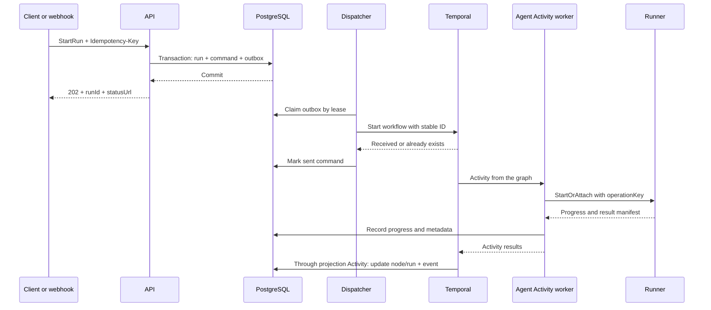

# Event-driven and durable execution

Status: proposed design, **September 5, 2026**. Overall architecture: [architecture.md](architecture.md).

## 1. Can the system use an event-driven architecture?

**Yes, and should be used in conjunction with a persistent state dispatcher.** Example webhook that creates run; progress broadcast agent; The approving user issues the continue command; The completed workflow broadcasts events to other systems.

If each service only listens to events and decides its own next step, the branch/join, timeout, and cancellation logic will be scattered. AgentFlow's recommendation is orchestration for the execution path, publish/subscribe for observability and integration.

Three different concepts:

- **Command:** work request, can be rejected, for example `StartRun`, `CancelRun`, `DecideApproval`.
- **Event:** announces that an event has been recorded, for example `run.started`, `approval.decided`.
- **Progress:** temporary information such as text delta or log; Not used to confirm node success.

Event-driven does not require Kafka. MVP uses PostgreSQL outbox, dispatcher and Temporal task queues; UI receives events via SSE. When you need fan-out to multiple independent services, add NATS JetStream. JetStream has persistence, replay and delivery at least once; Pure Core NATS has different characteristics. Source: [NATS JetStream](https://docs.nats.io/concepts/jetstream).

Do not apply event sourcing to all product data in MVP. Temporal history serves the recovery engine; run event log for audit/UI; Draft and membership workflows still use the usual relational model.

## 2. The path of a run



The API only returns `202` after the transaction has committed. If Temporal is suspended, run is in the queued state and the dispatcher tries again. If the dispatcher dies after Temporal has received but before updating the outbox, the resend uses the same workflow ID and the conflict/reuse policy refuses to create another execution. At the same time, the idempotency lock in the database must remain valid after Temporal history runs out of retention.

Transactional outbox resolves the gap between database commit and message delivery. Sending back can still create duplicates so the consumer must be idempotent. Source: [AWS — Transactional outbox pattern](https://docs.aws.amazon.com/prescriptive-guidance/latest/cloud-design-patterns/transactional-outbox.html).

## 3. Graph interpreter on Temporal

An AgentFlow Workflow Execution logic runs the graph interpreter with an immutable **snapshot workflow version**. The Interpreter is responsible for selecting qualified nodes, parallelism limits, branch/join, deadlines, and termination status.

In the Workflow code, only deterministic logic is implemented and uses Temporal's time/signal API. Calling model, filesystem, network, SDK agent, database and publish events are all through Activities. Activity results recorded in history are used when replaying; An Activity that has not recorded results can be rerun. Source: [Temporal TypeScript Workflow basics](https://docs.temporal.io/develop/typescript/workflows/basics).

Recommended Activity boundaries:

- `loadWorkflowSnapshot`: load snapshot/version/hash and return small data to history.
- `executeConnector`: call an external operation with idempotency key.
- `superviseAgent`: launch or reattach to runner job, heartbeat and get results.
- `persistProjection`: record UI state and domain event in the same transaction.
- `createApproval`: save approval request; Workflow waits for decision using Signal and timer.

Do not include each token in the Temporal history. Save large output in artifact storage; The activity returns the object reference, checksum, and small results needed for the branch. For large loops/subflows at later stages, limit the number of steps and use child workflow/Continue-As-New accordingly; need to transfer both state and list of processed commands to the next execution.

When deploying a new interpreter, use a history-compatible versioning/patching mechanism and run replay tests. Locking the DSL version is not enough: the interpreter code, node implementation, and runtime image must also be defined. Refer to the [Temporal TypeScript Workflows](https://docs.temporal.io/develop/typescript/workflows) documentation group.

## 4. Event contract

This is an internal proposal envelope, not a Codex/OpenCode API prototype, and does not claim to be CloudEvents compliant.

```json
{
  "eventId": "evt_01",
  "type": "agent.turn.completed",
  "schemaVersion": 1,
  "occurredAt": "2026-09-05T12:00:00Z",
  "tenantId": "tenant_01",
  "projectId": "project_01",
  "runId": "run_01",
  "nodeExecutionId": "exec_fix_01",
  "attempt": 1,
  "aggregateId": "exec_fix_01",
  "aggregateSequence": 12,
  "correlationId": "run_01",
  "causationId": "cmd_01",
  "traceparent": "00-4bf92f3577b34da6a3ce929d0e0e4736-00f067aa0ba902b7-01",
  "payload": {
    "provider": "codex",
    "sessionRef": "session_01",
    "resultRef": "artifact_result_01"
  }
}
```

`agent.turn.completed` only describes runtime status. The Node only succeeds after AgentFlow checks the output schema, saves the artifact, and Workflow records the results. Agent writing "done" in text is not a valid termination signal.

Rules:

1. Event ID remains the same when replaying the same event; Incompatible semantic changes increase the schema version.
2. Sequence increases in each aggregate, leveled by a transaction or a writer; does not assume global ordering based on timestamp.
3. UI uses a separate cursor server for stream by run; Do not mix UI cursors with sequences of multiple nodes.
4. Payload uses reference for large log/diff; contains no default credentials, full prompts, or sensitive data.
5. Consumer has unique key `(consumerId, eventId)` in the inbox, commits to the database in the inbox and then ACKs.
6. Consumers encountering old events cannot pull the terminal status back to running. Gap sequence causes consumers to load snapshots or wait for event compensation.

## 5. Retry and idempotency

Design for **at-least-once delivery**, do not promise exactly-once for operations on external systems.

`operationKey = tenantId / logicalRunId / nodeInvocationId / operationName`

The above key remains the same through technical retry. `attempt` is used for log, lease and costs; Do not include attempt in the anti-repeat key. When actively running again to create a new result, create a new invocation/run and save the connection to the previous one.

| Operation | How to avoid repetition |
| --- | --- |
| Duplicate webhooks | Unique by tenant + trigger + upstream delivery ID; payload hash detects key reuse with different content |
| Scheduler sends duplicate | Key according to trigger + expected calendar time; save timezone and missed run policy |
| Create runner job | Unique operation key; retry previous query/attach job |
| Record artifact | Object key immutable, checksum, finalize manifest idempotent |
| Call the API with idempotency | Pass along the key and keep a record of the result |
| Creating PR/API without strong enough idempotency | Check by repo, branch, marker/operation key; timeout if the result is unclear, switch to `RECONCILIATION_REQUIRED` |
| Receive decision approval | Unique command ID and check request status using compare-and-set |

Outbox/inbox does not automatically make an API call and database commit atomic. After the timeout, an external impact may have occurred. With uncontrollable impacts, stop to check instead of sending it back yourself.

| Error group | Recommended Policy |
| --- | --- |
| Rate limit, temporary network error | Limited retry, exponential backoff + jitter; respect Retry-After |
| Auth, wrong configuration/schema, policy deny | No automatic retry; return correctable errors |
| Agent output does not have the correct schema | Maximum one edit per budget; then fail node |
| Test failed | Business output `passed: false`, designed branch; no infinite retry |
| Worker dies, loses heartbeat | Reconcile the old job before continuing or rerunning |
| Out of budget/deadline | Cancel and cleanup; Do not consider it a network error to retry |

Temporal Activity has timeout/retry and receives cancellation via heartbeat. However, the worker or subprocess still needs to proactively handle cancellation; Engine-side timeout does not kill the process itself. Source: [Temporal Activity Execution](https://docs.temporal.io/activity-execution).

## 6. Worker dies and task is still running

Recommended runner supervisor with job registry, heartbeat, lease and fencing generation:

1. Activity gets lease for operation key, receives current generation.
2. Runner receives `StartOrAttach`; Do not create two jobs for the same operation key.
3. Activity heartbeat progress and lease; The runner holds the result manifest long enough for another worker to retrieve it.
4. When the worker dies, the new worker asks for the runner status. If the job is running, attach it; Once done, get the manifest.
5. If the runner is lost, restore the workspace from the snapshot and verify the session state. Only run a new attempt when you know the old job has stopped or has been fenced off from all important logs.
6. If the state of external impact has not been determined, mark the need for control. Simply locking the database does not prevent the old subprocess from continuing to call the API.

Fencing is effective only when the resource validates the token. Publishing operations should therefore go through the connector/tool gateway, which checks the generation and operation key; do not give publishing credentials directly to the coding agent.

## 7. Human approval

The Approval step of the workflow saves the request and waits for **Signal + durable timer**. Closing the UI or restarting the API does not remove the waiting state. Signal is used to update Workflow, Query is used to read; Access from users still goes through the decentralized API. Source: [Temporal message passing](https://docs.temporal.io/develop/typescript/workflows/message-passing).

The API checks reviewer scope, request expiry, action hash and status before writing command/outbox. Only one decision wins compare-and-set. Workflow checks the request ID/hash/deadline again and marks decision applied; If the dispatch period expires, the decision is rejected. The API returns “received” differently than “applied”.

Approval is associated with the correct diff/commit/operation and policy version. If Artifact changes, review again. Deny or timeout to the defined branch; Do not automatically turn timeout into consent.

Distinguish the approval workflow step from the permission request that appears in the middle of an agent's turn. The second type also depends on the runtime process and protocol, see [agent-integration.md](agent-integration.md).

## 8. Status, cancel and offset

Recommended node state:

```text
PENDING -> READY -> RUNNING -> SUCCEEDED
                     |-----> RETRY_WAIT -> READY
                     |-----> WAITING_APPROVAL -> RUNNING
                     |-----> RECONCILIATION_REQUIRED -> RUNNING or FAILED
                     |-----> FAILED / TIMED_OUT
PENDING / READY / RUNNING / WAITING_APPROVAL -> CANCEL_REQUESTED -> CANCELLED
PENDING -> SKIPPED (branch not selected)
```

`WAITING_APPROVAL -> RUNNING` only if the correct decision is applied; deny/expiry results in output or error according to configuration. Run has its own synthesis status: `QUEUED`, `RUNNING`, `WAITING_APPROVAL`, `NEEDS_ATTENTION`, `CANCEL_REQUESTED`, `CANCELLED`, `SUCCEEDED`, `FAILED`, Run only `WAITING_APPROVAL` when there are no active nodes and there are pending steps; A waiting branch does not block another running branch.

When cancel: stop scheduling new node, send cancel to Activity, adapter abort/interrupt, grace period expires, supervisor stops process/container tree. Indicator `CANCELLED` when stop processing is complete; Unverified job is displayed and needs to be checked. Run the terminal without changing state due to late event.

Cancel does not undo the called API. With multiple impact steps, the compensation declaration has its own idempotency, performed in reverse order of the successful steps. Irreversible effects must be demonstrated in the results; Do not declare rollback as a database transaction.

## 9. Streaming, backpressure and broker expansion

SSE reads event log according to cursor, supports reconnection by Last-Event-ID during retention. If the cursor expires, the UI receives instructions to load a new snapshot. Text delta can be batched and retention is short; lifecycle/approval/result must be persistent. Slow progress display does not change workflow results.

Limit concurrency by tenant/provider/runner pool; queue job before granting sandbox; Limit log bytes and artifact size. Need common budget for both retry and parallel branches. When adding JetStream, outbox waits for publish ACK, consumer ACK after commit; Save errors exceeding the number of retries to the parking table/queue with the redrive tool. Do not assume that the broker has its own dead-letter workflow that meets product needs.

Projection can be late when the database fails. Workflow retry Activity records projection; The watchdog compares the open run with the Temporal state to fix stuck records, even if the execution is terminated outside the application. Reconciler only edits the read model, does not automatically rerun the node or side effects.
