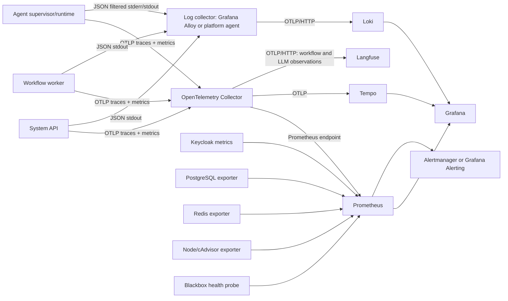

# Integrated monitoring and observability for AgentFlow

Updated date: **October 11, 2026**. Status: **Implemented stack observability and Langfuse self-host for local/Compose, including trace across API/queue/worker/node/Agent runtime; production hardening is not complete**.

This document describes how to add metrics, logs, traces, dashboards, and alerts to AgentFlow. The goal is to answer four operational questions:

1. Are APIs, workers, queues and dependencies available?
2. At what step is a workflow run slow or error-prone?
3. Is the error coming from AgentFlow, container runtime, database, queue or LLM provider?
4. Is the system about to exceed resource, backlog, token, or cost limits?

`runs` and `run_steps` remain authoritative sources of business data. Monitoring serves detection and diagnosis; Do not use Prometheus, Loki, Tempo or Langfuse to determine workflow status.

### Scope and results to be achieved

The scope of the plan includes two layers:

- **System monitoring:** System API, PostgreSQL, Redis, Keycloak, workflow worker, Docker host/container and pipeline telemetry itself.
- **Workflow monitoring:** run lifecycle, dispatch via outbox/Redis Stream, each node/attempt, Agent container, MCP/LLM calls, retry, timeout, backlog and estimated costs.

The end result must allow the operations team to detect the problem from the alert, determine the scope of impact on the dashboard, and then go from `run_id` or `trace_id` to the correct node, log, and dependency causing the error. Telemetry must not contain default secrets/prompts and monitoring failures must not interrupt workflow execution.

Beyond the scope of the first integration: Real User Monitoring for the frontend, continuous profiling, anomaly detection with ML, saving all prompts/completions and changing the execution engine. These items will only be added after the platform metrics/log/trace are stable and have corresponding data policies.

## 1. Current status and gaps

| Ingredients | Already | Need to add |
| --- | --- | --- |
| System API | `GET /health` liveness check; `GET /ready` tests PostgreSQL | OTLP application metrics, request trace, dependency spans, readiness of required dependencies |
| Workflow workers | Log in Python `logging`; Redis consumer group has reclaim | Structured log, trace through each node, queue/outbox metrics, worker heartbeat |
| Agent containers | Exit code, timeout and output limit are handled by supervisor | Duration, OOM/exit reason, container start, cleanup and artifact metrics |
| Keycloak | Enabled health and metrics on management port `9000` | Prometheus scrape and dashboard/alert |
| PostgreSQL, Redis | There is healthcheck in Compose | Exporter and warning capacity/latency |
| Web | Nginx healthcheck | Frontend error/performance telemetry at a later stage |
| LLM | `run_steps` save state/output | Token, cost, latency, retry/rate-limit; Langfuse is optional |

Do not consider Docker healthcheck as monitoring. Healthcheck only helps the runtime decide whether the container is alive/ready; New metrics and alerts show trends, load levels and causes of decline.

## 2. Proposed architecture



OpenTelemetry Collector is an acquisition boundary so that the application does not depend directly on a backend. Collector receives OTLP, batch/filter telemetry and then exports metrics to Prometheus and traces to Tempo. OpenTelemetry provides instrumentation and telemetry transmission, not storage or dashboard; see [OpenTelemetry Collector](https://opentelemetry.io/docs/collector/) and [OTLP exporter configuration](https://opentelemetry.io/docs/specs/otel/protocol/exporter/).

### Default toolkit

| Demand | Tools | Notes |
| --- | --- | --- |
| Instrumentation and transmission telemetry | OpenTelemetry SDK + Collector | Common standards for APIs, workers and runners |
| Metrics | Prometheus | Scrape Collector and infrastructure exporter |
| Logs | JSON stdout + Grafana Alloy + Loki | Do not write directly to Loki from business code |
| Traces | Tempo | Search by `trace_id`, linked from log/dashboard |
| Dashboard and alert | Grafana; Alertmanager when needing independent routing | Provision configuration from Git, no manual configuration in production |
| Infrastructure | Keycloak metrics, postgres/Redis exporter, cAdvisor/node exporter | Node Exporter for Linux; Windows hosts use Windows Exporter |
| Synthetic health | Prometheus Blackbox Exporter or platform probe | Check `/health` and `/ready` from outside process |
| Observe workflow and LLM | Langfuse | Run/node input-output, generation/token/latency has redaction and size limit |

Prometheus/Loki/Tempo can be replaced with a managed service that supports OTLP without changing the semantic instrumentation in the application. Grafana supports provisioning data sources and dashboards with files for version-control; see [Grafana provisioning](https://grafana.com/docs/grafana/latest/administration/provisioning/).

## 3. Data correlation model

All services use W3C Trace Context. `traceparent` must be transmitted via HTTP and internal business payload; With Redis Stream, store `traceparent`/`tracestate` in message fields or metadata instead of manually formatting the trace ID.

The following identifiers are placed in the **span attribute and structured log**, not as metric labels:

- `run_id`, `workflow_id`, `workflow_version_id`;
- `node_id`, `node_execution_id`, `attempt_id`;
- `job_id`, `runner_id`, `container_id`;
- `tenant_key`/`project_key` has impersonated if needed to investigate according to access scope.

Do not record `owner_subject`, email, or raw user identifiers to telemetry. The tenant/project mapping must be stable within the scope of investigation, must not allow identity inversion, and must comply with the access permissions of the observing backend.

Resource attributes are stable across all signals:

```text
service.name=agentflow-system | agentflow-workflow-worker | agentflow-runner
service.version=<git-sha-or-release>
deployment.environment=local | staging | production
service.instance.id=<instance-id>
```

Metric labels only use small and finite sets of values, for example `service`, `route`, `method`, `status_code`, `node_type`, `runtime`, `provider`, `status`, `error_code`. Do not use the full URL, exception message, prompt, model response, user ID or UUID. Prometheus recommends controlling cardinality and converting unlimited incremental data to log/trace instead of labels; see [Prometheus instrumentation practices](https://prometheus.io/docs/practices/instrumentation/).

## 4. Telemetry to emit

The metric name below is the proposed contract. Use base unit in the name (`seconds`, `bytes`) and counter ending in `_total`.

### API and dependencies

| Metrics | Type | Limited Labels | Meaning |
| --- | --- | --- | --- |
| `agentflow_http_server_requests_total` | Counter | `method`, `route`, `status_code` | API throughput and error rate |
| `agentflow_http_server_duration_seconds` | Histogram | `method`, `route`, `status_code` | Latency API; `route` is the route template |
| `agentflow_dependency_requests_total` | Counter | `dependency`, `operation`, `status` | PostgreSQL, Redis, provider, MCP |
| `agentflow_dependency_duration_seconds` | Histogram | `dependency`, `operation`, `status` | Latency dependency |
| `agentflow_db_pool_connections` | UpDownCounter/Gauge | `state` | Pool used/idle/overflow |

### Workflow, queue and outbox

| Metrics | Type | Limited Labels | Meaning |
| --- | --- | --- | --- |
| `agentflow_runs_started_total` | Counter | `trigger_type` | Run is received sustainably |
| `agentflow_runs_completed_total` | Counter | `status` | Terminal result of run |
| `agentflow_run_duration_seconds` | Histogram | `status` | Machine execution time; separate approval waiting time |
| `agentflow_node_attempts_total` | Counter | `node_type`, `status`, `error_code` | Attempt, retry and normalized error |
| `agentflow_node_duration_seconds` | Histogram | `node_type`, `status` | Node time |
| `agentflow_queue_messages` | Gauge | `state` | Ready/pending/reclaimable messages |
| `agentflow_queue_oldest_age_seconds` | Gauge | No | Age of oldest unprocessed message |
| `agentflow_outbox_pending` | Gauge | No | Unpublished dispatch number |
| `agentflow_outbox_oldest_age_seconds` | Gauge | No | Oldest outbox age not yet dispatched |
| `agentflow_worker_heartbeat_timestamp_seconds` | Gauge | `worker_pool` | Detect worker pool losing heartbeat |

If you need to know the backlog by large tenant, use top-N reports from PostgreSQL or analytical logs; Do not add `tenant_id` to the Prometheus label.

### Runner, agent and LLM

| Metrics | Type | Limited Labels | Meaning |
| --- | --- | --- | --- |
| `agentflow_agent_jobs` | Gauge | `state`, `runtime` | Queued/running/cleanup pending |
| `agentflow_agent_job_duration_seconds` | Histogram | `runtime`, `status`, `error_code` | Attempt agent time |
| `agentflow_agent_container_start_seconds` | Histogram | `runtime`, `status` | Container creation/start time |
| `agentflow_agent_container_exits_total` | Counter | `runtime`, `reason` | Exit, timeout, OOM, cancelled |
| `agentflow_agent_cleanup_total` | Counter | `status` | Cleanup and orphan reconciliation |
| `agentflow_llm_requests_total` | Counter | `provider`, `model_family`, `status` | Request, error and rate-limit |
| `agentflow_llm_duration_seconds` | Histogram | `provider`, `model_family`, `status` | Provider latency |
| `agentflow_llm_tokens_total` | Counter | `provider`, `model_family`, `token_type` | Input/output/cache tokens if the provider returns usage |
| `agentflow_llm_cost_estimate_total` | Counter | `provider`, `currency` | Estimated according to saved pricing version |

Do not include a free model name on the label. Map the allowed model to finite `model_family` or leave the full model in span/log.

### Minimum spans

- HTTP server span for each API request; Remove `/health`, `/ready` from detailed sampling if causing noise.
- `workflow.dispatch`, `workflow.run`, `workflow.node` and `workflow.node.attempt`.
- `redis.xadd`, `redis.xreadgroup`, `redis.xack`, `redis.xautoclaim`.
- PostgreSQL query spans have been sanitized; Do not collect statements containing secrets/payloads.
- `agent.container.create`, `agent.container.wait`, `agent.result.validate`, `agent.cleanup`.
- `llm.chat` and `mcp.tool.call`, only record secure metadata such as provider, model family, tool name, token count and status.

## 5. Structured log and data protection

The application writes one JSON object per line to stdout/stderr. Background Schema:

```json
{
  "timestamp": "2026-10-04T08:30:00.000Z",
  "level": "INFO",
  "service": "agentflow-workflow-worker",
  "environment": "local",
  "event": "workflow.run.completed",
  "message": "Workflow run completed",
  "trace_id": "4bf92f3577b34da6a3ce929d0e0e4736",
  "span_id": "00f067aa0ba902b7",
  "run_id": "...",
  "node_execution_id": "...",
  "status": "succeeded",
  "duration_ms": 1240
}
```

Required rules:

- use stable `event` for querying; `message` serves readers only;
- exception includes `error.type`, `error.code` normalization and stack trace; Do not use the entire exception message as a label;
- default does not log access tokens, API keys, cookies, Authorization headers, raw provider request/response, prompts, tool arguments/output or artifact content;
- redaction according to allowlist at source before telemetry leaves the process; Collector is a second layer of defense, not the only one;
- limit log size from agent and mark `truncated=true` when cutting;
- Loki labels only include `service_name`, `environment`, `level`; keep run/node/trace ID in structured metadata to avoid high cardinality. Loki supports receiving OTLP logs via native endpoint; see [Loki OTLP ingestion](https://grafana.com/docs/loki/latest/send-data/otel/).

The initial retention for the internal environment can be metrics of 30 days, logs of 14 days and traces of 7 days. This is an operational value that needs to be determined according to capacity, audit requirements and data policy; The lifecycle of a business event/artifact is a separate policy.

## 6. How to deploy in repository

Slice deployment; Each stage must be used independently and have acceptance criteria.

### Phase 1 — Build local monitoring stack

Add expected structure:

```text
docker/
  compose.observability.yaml
  observability/
    otel-collector.yaml
    prometheus.yaml
    rules/agentflow.yaml
    tempo.yaml
    loki.yaml
    alloy.alloy
    grafana/
      provisioning/datasources/agentflow.yaml
      provisioning/dashboards/agentflow.yaml
      dashboards/system-overview.json
      dashboards/workflow-runtime.json
```

Keep the stack in the Compose override file so that the core `docker/compose.yaml` remains lightweight. Services should be on the same network `backend`; Only Grafana (`127.0.0.1:3001`) and Prometheus UI when needed for debugging (`127.0.0.1:9090`) are bound to localhost. Do not publish OTLP, Loki, Tempo, exporter or management ports in production.

Minimum collector for traces and application metrics:

```yaml
receivers:
  otlp:
    protocols:
      grpc:
        endpoint: 0.0.0.0:4317
      http:
        endpoint: 0.0.0.0:4318

processors:
  memory_limiter:
    check_interval: 1s
    limit_mib: 256
  batch: {}

exporters:
  prometheus:
    endpoint: 0.0.0.0:8889
  otlp/tempo:
    endpoint: tempo:4317
    tls:
      insecure: true

service:
  pipelines:
    metrics:
      receivers: [otlp]
      processors: [memory_limiter, batch]
      exporters: [prometheus]
    traces:
      receivers: [otlp]
      processors: [memory_limiter, batch]
      exporters: [otlp/tempo]
```

Minimum Prometheus scrape:

```yaml
global:
  scrape_interval: 15s
  evaluation_interval: 15s

rule_files:
  - /etc/prometheus/rules/*.yaml

scrape_configs:
  - job_name: otel-collector
    static_configs:
      - targets: [otel-collector:8889]
  - job_name: keycloak
    metrics_path: /metrics
    static_configs:
      - targets: [keycloak:9000]
```

Keycloak now has `KC_METRICS_ENABLED=true` enabled; Endpoint `/metrics` uses OpenMetrics on the management interface. See [Keycloak metrics](https://www.keycloak.org/observability/configuration-metrics). Add PostgreSQL/Redis exporter after setting credential using Compose secret or secret manager, do not embed password in scrape config file.

Expected command after the above files are deployed:

```powershell
docker compose -f docker/compose.yaml -f docker/compose.observability.yaml config
docker compose -f docker/compose.yaml -f docker/compose.observability.yaml up -d --build
docker compose -f docker/compose.yaml -f docker/compose.observability.yaml ps
```

Acceptance criteria: Grafana itself has three data sources Prometheus/Loki/Tempo; Prometheus target Collector and Keycloak are both `UP`; restarting the stack does not cause provisioning to be lost.

### Phase 2 — Instrument System API and workflow worker

1. Add and version lock Python packages: OpenTelemetry SDK, OTLP exporter and instrumentation for FastAPI, ASGI, HTTPX, SQLAlchemy, Redis and logging. Python OpenTelemetry supports instrumentation library for framework/dependency; see [OpenTelemetry Python libraries](https://opentelemetry.io/docs/languages/python/libraries/).
2. Create `src/system/core/telemetry.py` with an idempotent constructor. Function to configure resource, tracer provider, meter provider, OTLP exporter, sampling and shutdown flush.
3. Call initialization before creating the FastAPI app and before the loop in `runtime.worker`. Do not reinitialize the provider after fork/process start.
4. Instrument FastAPI/HTTPX/SQLAlchemy/Redis automatically; Create manual spans and domain metrics at dispatch, run, node, agent container and provider boundaries.
5. Convert the scattered `logging.basicConfig` configuration to a common logging module, inject `trace_id`/`span_id` and export JSON.
6. Register shutdown hook to flush telemetry with time limit; Exporter errors should not break the workflow.

General environment variables:

```dotenv
OTEL_SDK_DISABLED=false
OTEL_EXPORTER_OTLP_ENDPOINT=http://otel-collector:4317
OTEL_EXPORTER_OTLP_PROTOCOL=grpc
OTEL_RESOURCE_ATTRIBUTES=deployment.environment=local
OTEL_TRACES_SAMPLER=parentbased_traceidratio
OTEL_TRACES_SAMPLER_ARG=1.0
OTEL_METRIC_EXPORT_INTERVAL=15000
LOG_FORMAT=json
LOG_LEVEL=INFO
```

Set `OTEL_SERVICE_NAME` separately for `system` and `workflow-worker`; Do not stuff the service name into the shared `OTEL_RESOURCE_ATTRIBUTES`. Local can sample 100%; Production starts lower and always keeps the error/slow trace with tail sampling at the Collector if there is enough capacity. Do not enable capturing HTTP body, SQL parameters, or sensitive headers.

Acceptance criteria: API call to create run generates a distributed trace connecting API → outbox/Redis → worker → node; log of the same run found with `trace_id`; Prometheus has request/run/node metrics but no UUID in labels.

### Phase 3 — Collect logs and infrastructure metrics

1. Configure Alloy to read Docker container stdout/stderr, parse JSON, add `service_name` and send OTLP/HTTP to Loki. In Kubernetes, replace it with the platform's DaemonSet/agent.
2. Scrape PostgreSQL exporter and Redis exporter with read-only/least-privileged account.
3. Use Blackbox Exporter or the platform's synthetic probe to call `/health` and `/ready` from outside the process; health `200` inside the container does not prove that the network connection from the load balancer is still active.
4. On Linux runner, use node exporter for host and cAdvisor or runtime metrics for container. Docker Desktop on Windows runs containers in a Linux VM, so the Windows host metric needs its own Windows Exporter if it really needs to observe the host.
5. Scrape self-metrics of Collector, Prometheus, Loki and Tempo to detect pipeline telemetry drop/backpressure.

Acceptance criteria: can go from an error panel → exemplar/trace → log according to `trace_id`; There is a CPU/RAM/disk dashboard, DB connections, Redis memory/pending entries and an OOM container.

### Phase 4 — Dashboard, SLOs and alerts

Provision at least three dashboards:

- **System overview:** request rate/error/latency, dependency health, DB pool, Redis, worker heartbeat.
- **Workflow runtime:** started/completed/failed, duration, queue age, outbox lag, and node retries/errors by type.
- **Agent runtime & LLM:** queued/running, container start/OOM/timeout/cleanup, provider latency/429, token and cost estimate.

Initial PoC goals, not yet production SLA:

| SLI | Goal |
| --- | --- |
| API durable start availability | 99.5% within 30 day window, declared maintenance type |
| Start API latency | p95 under 500 ms for small payloads |
| Queue wait | p95 under 5 seconds at acceptance load |
| Progress towards UI | p95 under 2 seconds, excluding provider time |
| Detect worker losing heartbeat | under 60 seconds |
| Cleanup container terminal | p99 under 60 seconds |

Initial alert:

| Alert | Suggested conditions | Level |
| --- | --- | --- |
| `AgentFlowSystemDown` | `probe_success{job="agentflow-system-health"} == 0` in 2 minutes | page |
| `AgentFlowApiHighErrorRate` | 5xx > 5% and enough flow for 10 minutes | page |
| `AgentFlowQueueStalled` | queue oldest age > 5 minutes and increasing | page |
| `AgentFlowOutboxStalled` | outbox oldest age > 1 minute in 5 minutes | ticket/page by load |
| `AgentFlowWorkerMissing` | heartbeat age > 60 seconds with backlog | page |
| `AgentFlowAgentFailureSpike` | timeout/OOM/runtime error increased abnormally | tickets |
| `AgentFlowProviderRateLimited` | 429 rate exceeds the threshold by provider | tickets |
| `TelemetryPipelineDropping` | Collector/Loki/Prometheus reports dropped/refused data | tickets |

Use `for` to avoid flickering alerts and annotate with dashboard/runbook URL. Prometheus alerting rules support a hold condition before firing; see [Prometheus alerting rules](https://prometheus.io/docs/prometheus/latest/configuration/alerting_rules/). Do not send `run_id` in general notifications; Operator accesses trace/log by time and service.

### Phase 5 — Langfuse self-host (deployed to local)

`docker/compose.langfuse.yaml` adds Langfuse web/worker, native PostgreSQL,
ClickHouse, Redis and MinIO. This is still an optional override to non-core Compose
incur resource costs when there is no need to observe workflow/LLM.

Mappings in use:

- request creates run and `workflow.run` is chain/root observation, equal correlation
  `run_id`, `workflow_id` and `workflow_version_id`;
- each node is observation; Agent node uses type `agent`, normal node uses
  `span` and also input/output/status/error are attached;
- direct provider call is `generation`, with provider/model and token usage;
- LangChain/LangGraph in the disposable Agent container is automatically OpenInference
  instrument, and receives `traceparent`/`tracestate` from worker;
- Collector filters by `agentflow.langfuse.export` or
  `openinference.span.kind`, then send OTLP/HTTP to `/api/public/otel`; All traces remain
  sent to Tempo;
- credential-like keys are replaced by `[REDACTED]`, strings and collections are limited
  For example, payloads beyond `LANGFUSE_MAX_IO_BYTES` only have size and SHA-256;
- exporter uses asynchronous queue/retry; Langfuse error does not cause node failure or replacement
  state `run_steps`.

Override local/dev set `LANGFUSE_TRACES_SAMPLER_ARG=1.0` to save all workflow runs.
If this value is reduced, sampling is determined at the API root and the entire span tree
of that run can be kept or abandoned; Langfuse should not be expected to still have all the tremors.

Boot and test according to the “Enable Langfuse local” section in `docker/README.md`.
`LANGFUSE_ENABLED=false` turns off the output observation workflow. Production should start with
`LANGFUSE_ENABLED=false`, `OPENINFERENCE_HIDE_INPUTS=true` and
`OPENINFERENCE_HIDE_OUTPUTS=true`, only turns on after latching data classification, permissions
access and retention. See [Langfuse OpenTelemetry integration](https://langfuse.com/integrations/native/opentelemetry) and [OpenInference data configuration](https://arize-ai.github.io/openinference/spec/configuration.html).

## 7. Readiness, liveness and dependency policy

- `/health`: only confirms process/event loop is alive; don't call dependency.
- `/ready`: confirms the instance can receive new jobs. API requires PostgreSQL; If receiving runs requires a direct queue, Redis is checked, and the outbox model can still be ready when Redis fails within the specified backlog limits.
- Workers do not need HTTP server just for healthcheck. Record a persistent heartbeat or timestamp metric and let the orchestrator/runtime monitor the process.
- Do not include the LLM provider in general readiness: the failed provider must be degraded/retryed according to the provider, do not withdraw the entire API from the load balancer.
- Endpoint metrics/health does not contain secrets, but is still only open in the management network. Keycloak also isolates health on the management port according to [health check instructions](https://www.keycloak.org/observability/health).

## 8. Testing and failure drill

Checklist for each change of instrumentation or monitoring config:

1. Validate Compose and Collector/Prometheus configuration before restarting.
2. Create a successful HTTP/transform/simulated agent workflow; Confirm all traces, metrics and JSON logs.
3. Give the node an error on purpose; Confirm error code is consistent and alert/dashboard raises correctly.
4. Stop `workflow-worker`; Confirm queue age increases and alert heartbeat/backlog fires then resolve automatically after recovery.
5. Stop Redis; Confirm the outbox holds the command, the API behaves according to policy and does not lose performance.
6. Stop Collector/Loki/Tempo; The workflow still runs, the exporter retry is limited and does not fill memory/disk.
7. Create log containing fake tokens; check the token does not appear in Loki, trace, dashboard or alert.
8. Check the series list to make sure there are no `run_id`, UUID, dynamic URL or error message labels.

Definition of Done for first integration:

- dashboard and data source are provisioned from repository;
- a run can look up APIs, queues, workers and nodes using trace/log;
- metric cover golden signals: traffic, errors, latency, saturation;
- Important alerts have owner, severity, runbook and tested firing/resolution;
- telemetry outage does not affect the correctness of the workflow;
- sensitive secret/payload passes redaction test;
- retention, access and backups are recorded for each backend.

## 9. Production hardening

- Lock image and package versions; Run migration/upgrade test on staging.
- Use TLS and authentication for OTLP/remote write when telemetry passes through the network boundary.
- Separate credential reader exporter, Grafana admin and alert integration; saved in secret manager.
- Set up appropriate memory limiter, batch, queue/retry and disk buffer for Collector/Alloy; Monitor key pipeline observability.
- Use object storage for Loki/Tempo when retention and HA require; local filesystem is only suitable for development/PoC.
- Set ingest quotas, label/attribute/log size limits, and sampling budgets so that a failed workflow doesn't crash monitoring.
- Grafana decentralization by team/project; UUIDs that are difficult to guess are not a security mechanism. Multi-tenant telemetry must have isolation before end-user access.
- Keep an out-of-cluster monitoring line for the health of the monitoring stack in production; If the entire stack fails, the internal alert will not be sent.

## 10. Suggested change order

| Order | PR Scope | Verifiable results |
| --- | --- | --- |
| 1 | Compose override, Collector, Prometheus, Tempo, Loki, Grafana provisioning | Stack local and Keycloak target `UP` |
| 2 | Telemetry bootstrap + JSON logging for the System API | HTTP traces/metrics/log correlation |
| 3 | Worker propagation + workflow/node domain metrics | A run is connected via queue and worker |
| 4 | Alloy and infrastructure exporters | Logs/host/DB/Redis dashboard |
| 5 | Dashboard, alert rules and failure drills | Alert firing/resolution has runbook |
| 6 | Agent container + LLM usage/cost; Langfuse if needed | Runtime/provider visibility and budget tracking |

Don't deploy all in one PR. The first slice should demonstrate a run request with correlated metrics, traces, and logs; Then increase the number of exporters, dashboard and retention.

## 11. Handover plan

The plan below uses **instalments** instead of a fixed date commitment. Each wave only begins when the previous wave's gate has been reached; Actual duration depends on CI/CD environment and production platform.

| Batch | Scope | Main role | Depends | Gate completed |
| --- | --- | --- | --- | --- |
| 0 — Baseline | Close SLI, error taxonomy, cardinality budget, retention and access | Tech lead + operations + security | Owner on duty and alert channel | Have decision documents; Measure load baseline and current log capacity |
| 1 — Local platform | Compose override, Collector, Prometheus, Loki, Tempo, Grafana; scrape Keycloak | Platform/DevOps | Phase 0 | Repeatable boot stack; config validation via CI; data source is provisioned |
| 2 — System visibility | Bootstrap OpenTelemetry, JSON log, API/dependency spans and metrics | Backend | Collector from round 1 | API → PostgreSQL/Redis has trace; log join with `trace_id`; no secrets revealed |
| 3 — Workflow visibility | Passing trace context via Redis, run/node/queue/outbox/worker metrics, Agent/LLM spans | Backend/runtime | Phase 2 | One successful run and one error run are traced throughout; UUID does not appear in metric labels |
| 4 — Operation | Dashboard, recording/alert rules, notification routing, runbook and failure drills | Platform + on-call | Phase 3 | Alert firing/resolution attempted; on-call handles the worker/Redis/provider error scenario |
| 5 — Production | TLS/auth, HA/storage, quota, sampling, backup, external probe and capacity test | Platform + security | Phase 4 | Staging soak test passed; rollback tried; production sign-off |

### Responsibility

| Group | Responsibility |
| --- | --- |
| Backend | Instrument API, database/Redis client, outbox and error code standardization |
| Workflow/runtime | Instrument run/node/attempt, Agent container, MCP/LLM and trace propagation |
| Platform/DevOps | Operate Collector/backends/exporter, storage, dashboard, alert routing and backup |
| Security/data owner | Browse redaction, retention, access, tenant isolation, and data sent to managed services |
| On-call/service owner | Get SLOs, warning thresholds, runbooks and post-incident reviews |

Each alert must have exactly one main owner. Do not turn on alert production if there is no recipient, runbook, related dashboard, and self-resolving criteria.

### Rollout and rollback

1. Turn on telemetry locally, then staging with low sampling; Compare CPU overhead, RAM, latency and series number before/after.
2. Bring the dashboard to the front, run the alert in recording mode or test channel to adjust the threshold.
3. Canary a System API instance and a worker before fully enabling it; Monitor exporter queue, dropped spans/logs and event-loop latency.
4. Rollback the application using `OTEL_SDK_DISABLED=true` and `LOG_FORMAT=text`; The workflow must continue to run when the Collector/backend is unavailable.
5. Rollback stack by removing `docker/compose.observability.yaml`; Do not delete the telemetry volume in the same operation so that investigation data remains.

## 12. Minimum runbook

| Signals | First Check | Initial safety action | Escalate when |
| --- | --- | --- | --- |
| API down or 5xx high | `/health`, `/ready`, DB pool, PostgreSQL and nearest deploy | Stop rollout; restore healthy instance; Do not restart the database blindly | No instance ready or data/migration errors |
| Outbox increased | PostgreSQL, dispatcher error and Redis connection | Keep API according to dependency policy; Redis/dispatcher recovery; observe drain rate | Outbox age exceeds SLO or backlog continues to increase after recovery |
| Queue stuck | Worker heartbeat, Redis pending/reclaim, run is `running` | Start the replacement worker; for the reclaim/idempotency mechanism to process | Run has side effects with unknown status or repeated errors with node |
| Workflow error increased | `node_type`, `error_code`, trace and provider/MCP latency | Zone node/provider; Turn off trigger or limit concurrency if needed | The error spreads across multiple workflows/tenants or there is a risk of side effects being duplicated |
| Agent timeout/OOM | Container exit reason, memory, output size and cleanup | Reduce concurrency; keep redaction artifact/log for investigation | There are orphan containers, resource leaks or incomplete cleanup |
| Provider 429/error | Rate by provider/model family, retry and `Retry-After` | Reduce concurrency; apply backoff; Switch provider only according to approved policy | Budget error is exhausted, many providers have the same error or costs increase abnormally |
| Telemetry dropped | Collector queue/refused metrics, disk and backend ingest | Reduce sampling/log volume; limited buffer increase | Monitoring is completely lost or affects the workload |

After the incident, compare the final status with `runs`/`run_steps`, do not infer business results from log or trace alone. All redrive/retry operations must comply with the idempotency and reconciliation of the workflow.

## 13. Decisions need to be finalized before production

- Use Grafana Alerting or Alertmanager as the main routing place;
- self-host or managed for metrics/logs/traces, with data storage location;
- retention and quota by environment, estimated ingest/day and budget;
- Sampling according to traffic, how to keep error/slow trace and cardinality budget;
- alert channel, on-call schedule, severity and response time;
- tenant isolation, prompt/content lookup permissions and temporary permissions process;
- whether to implement Langfuse or not; If so, which data fields are allowed to be sent?

These decisions must be recorded as configuration or an ADR in the repository. Do not let production values exist only as manual adjustments in the Grafana UI.
