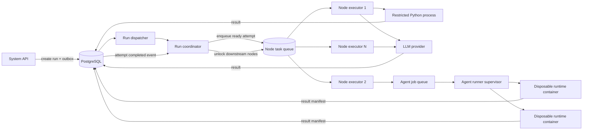
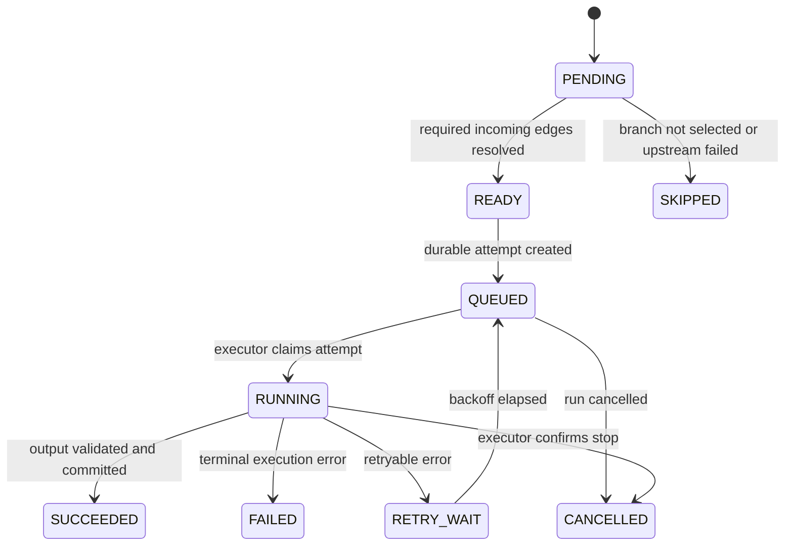

# Parallel workflow execution design

Date: **October 22, 2026**. Status: **Phase 1 single-run scheduling slice
implemented; multi-run and durable node distribution remain target designs**.

This document defines how AgentFlow should execute independent workflow nodes at
the same time without violating graph dependencies. It extends
[workflow persistence and execution](workflow-execution.md) and keeps the safety
and recovery invariants in the
[core runtime implementation plan](core-runtime-implementation-plan.md).

## 1. Goal

Reduce workflow latency by allowing several ready nodes and several workflow runs
to make progress concurrently. A node may execute restricted Python, call an LLM,
or invoke an Agent runtime. The system must still:

- start a node only after its required upstream results are committed;
- respect selected `if` branches and parallel/join semantics;
- enforce per-run and system-wide concurrency limits;
- persist every attempt so a worker restart does not lose or duplicate work;
- prevent a late or duplicate worker from overwriting the accepted result; and
- cancel, retry, observe, and account for each node independently.

Parallelism improves only the part of a graph that has independent branches. A
linear workflow remains sequential. With enough worker capacity, the minimum run
time is approximately the duration of the graph's critical path plus scheduling
overhead, rather than the sum of every node duration.

## 2. Current behavior and limitation

The current implementation has useful in-process concurrency:

- one Redis message represents one complete workflow run;
- one workflow worker claims and leases that run;
- `runtime/engine.py` finds all simultaneously ready nodes;
- it starts ready nodes as bounded tasks and reacts to each completion, limited by
  `settings.maxParallelNodes` (default `4`, maximum `32`);
- LLM and Agent calls can wait concurrently because they use asynchronous APIs.

As of October 22, 2026, a fast branch can unlock its downstream node without
waiting for an unrelated slow branch in the same scheduling wave. Restricted
Python is sent to a bounded `PYTHON_EXECUTOR_THREADS` pool so it does not block
LLM calls, Agent calls, or graph scheduling on the async event loop.

The scheduler benchmark can be repeated with:

```powershell
cd src/system
uv run python -m tests.benchmark_parallel_workflow
```

On October 22, 2026, one workflow containing four independent simulated
200-millisecond Agent nodes completed in `0.864 s` with `maxParallelNodes=1` and
`0.215 s` with `maxParallelNodes=4`, a `4.02x` scheduler speedup. A second graph
with a fast branch feeding a downstream node while an unrelated slow branch was
still active completed in `0.415 s`; the previous scheduling-wave barrier would
take approximately `0.600 s`. This benchmark isolates scheduling with fake Agent
I/O; real provider and container performance also includes model latency, image
startup, host capacity, and provider limits.

The remaining limitations are:

- the worker loop awaits one run message before processing the next message;
- graph state and node outputs live mainly in one worker process while the run is
  executing;
- restricted Python uses threads for event-loop isolation, but CPU-heavy Python
  still needs the target process pool or isolated code runner for true CPU
  parallelism; and
- a node cannot be transferred independently to another workflow worker.

Therefore, adding unbounded threads around the current engine is not sufficient.
The target is a bounded, durable node-task scheduler. Threads are only one
implementation mechanism inside an executor; database state, leases, and
operation keys provide correctness.

## 3. Target architecture



### Run coordinator

The coordinator is the only component that decides which nodes are ready. It
loads the immutable workflow version, records branch decisions, evaluates
dependencies, and creates durable node-attempt jobs. It does not execute Python,
make provider requests, or wait directly for an Agent container.

There may be many coordinator processes, but only the process holding the run's
current lease generation may schedule work or commit graph-state transitions.
This preserves a single logical writer without limiting execution to a single
machine.

### Node executor pool

Every node executor uses the same attempt contract and may claim any compatible
job. It resolves the node input from committed upstream outputs, executes the
adapter, validates the output schema, and commits the result. Executors are
stateless between attempts; they must not depend on another thread's memory.

The pool can begin as several tasks in each worker process and scale to several
worker processes or hosts. Work is distributed by the queue, so a node is not
pinned to the worker that coordinated its run.

### Agent runner supervisor

An Agent executor submits a persistent `agent_job` containing the attempt ID,
runtime ID, prompt, input, schema, policy, and references to secrets or artifacts.
The supervisor claims the job, creates one disposable container for that attempt,
writes the invocation contract to the runtime, and collects the validated result
manifest.

The workflow worker should not receive a Docker socket in the production target.
Separating the supervisor still allows many Agent nodes to run in parallel while
limiting container capacity and reducing control-plane privilege. A local
development deployment may run these logical roles in fewer processes.

## 4. Dependency and ordering rules

A node moves through the following states:



The coordinator may mark a node `READY` only when all these conditions hold:

1. Every required incoming edge has reached a terminal decision.
2. At least one incoming control edge is active, unless the node is a root.
3. Every upstream output referenced by the node input has been committed.
4. The node has no active or successful attempt for the same activation.
5. The run is not cancelled, timed out, failed, or otherwise terminal.

A ready node moves to `QUEUED` only after the coordinator can reserve a
concurrency permit atomically. Lack of capacity delays dispatch; it does not make
the node or its dependencies invalid.

For an `if` node, only the selected `true` or `false` edge becomes active. For a
`parallel` node, every `parallel` edge becomes active. A join waits for terminal
decisions from all required incoming branches; an inactive branch is `SKIPPED`,
not silently treated as successful.

The order in which independent nodes finish is intentionally nondeterministic.
Correctness comes from dependency state and committed outputs, never from thread
start order, node sequence number, or timing.

## 5. Execution model by node type

| Node category | Execution mechanism | Concurrency behavior |
| --- | --- | --- |
| Pure graph nodes (`if`, `parallel`, schema, small transforms) | Coordinator or lightweight executor task | Fast and non-blocking; do not consume scarce Agent capacity |
| `code.python` | Current: bounded thread pool. Target: bounded process pool or isolated code runner | Threads protect event-loop progress; process isolation is still required for true CPU parallelism and stronger CPU, memory, and time limits |
| `llm.call` | Async provider client | Many calls may wait concurrently; enforce provider/model and owner limits and honor rate-limit backoff |
| `agent` | Persistent Agent job handled by runner supervisor | One disposable container per attempt; concurrency is bounded by runtime/host capacity |
| Blocking connector or legacy SDK | Bounded thread pool until an async adapter exists | Never use the event loop's unbounded default executor |

The current bounded thread pool keeps small restricted-Python transformations off
the event loop. Python CPU work should ultimately use processes rather than
ordinary Python threads. LLM requests and job/result polling are I/O-bound and
should use async tasks instead of dedicating one operating-system thread per
request. This provides the intended parallel behavior without making correctness
depend on Python's thread scheduling.

## 6. Dispatch and result protocol

### Dispatch

1. The coordinator locks or fences the run state.
2. It calculates the complete ready set from committed node states.
3. It reserves up to the remaining per-run concurrency limit.
4. In one transaction, it changes each node to `QUEUED`, creates a
   `node_attempt`, and creates a node-dispatch outbox row.
5. The dispatcher publishes attempt IDs to the node task queue.
6. Any executor with the required capability may claim an attempt.

The queue message carries identifiers, not secrets or the complete mutable graph.
The executor reloads the immutable workflow snapshot and attempt record, then
resolves credentials immediately before the external call.

### Result collection

1. The executor changes the attempt from `QUEUED` to `RUNNING` using an atomic
   claim and records its lease generation.
2. It invokes the node adapter. For an Agent node, it submits an `agent_job` and
   awaits or polls the same durable job ID; it must not create a new container on
   every poll.
3. It validates and size-checks the response. Large results become immutable
   artifacts with checksums.
4. In one transaction, it verifies the attempt fence and run execution epoch,
   records the terminal result, updates the step projection, releases concurrency
   permits, and appends a completion event/outbox row.
5. The coordinator consumes the completion, recalculates readiness, and enqueues
   newly unblocked nodes.

Only a committed result can unlock a downstream node. An HTTP response, completed
container, or in-memory future by itself is not proof that the step succeeded.

## 7. Concurrency limits and backpressure

Concurrency must be bounded at several levels. The effective limit for an
attempt is the smallest applicable limit.

| Scope | Purpose | Initial policy |
| --- | --- | --- |
| Per workflow run | Prevent one graph from starting every ready node at once | `settings.maxParallelNodes`, default `4`, maximum `32` |
| Per worker process | Protect file descriptors, memory, and event-loop latency | Configured executor-task capacity |
| Restricted Python pool | Protect event-loop latency now and CPU/memory in the target runner | Current thread limit is explicit; future process slots must not exceed assigned CPU capacity |
| Agent runner/host | Protect Docker/container resources | Explicit container slots by runtime and host |
| Provider/model | Respect rate and connection limits | Separate semaphore/token bucket per provider and model |
| Owner/project | Prevent noisy-neighbor starvation | Quota for active attempts, containers, tokens, and queued jobs |
| Global deployment | Shed load before dependencies fail | Maximum queued and running attempts with admission control |

A task that cannot obtain capacity stays durably `READY` or `QUEUED`; the
coordinator does not spin or create more threads. Fair scheduling should use an
owner-aware queue so one large workflow cannot consume every executor slot.

Suggested configuration names for the implementation are:

```text
WORKFLOW_RUN_CONCURRENCY          # runs coordinated concurrently per process
NODE_EXECUTOR_CONCURRENCY         # async node attempts per executor process
PYTHON_EXECUTOR_THREADS           # current restricted Python offload slots
PYTHON_EXECUTOR_PROCESSES         # target restricted Python process slots
AGENT_RUNNER_CONCURRENCY          # active disposable containers per runner
PROVIDER_CONCURRENCY_DEFAULT      # fallback calls per provider
```

`PYTHON_EXECUTOR_THREADS` is implemented. The other names describe the target
contract and are not current environment variables until their implementations
are merged.

## 8. Reliability, retry, and cancellation

- Delivery is at-least-once. `operation_key` is stable for a logical node
  activation; `attempt_id` changes only for an explicit retry.
- A duplicate queue delivery attaches to or ignores the existing attempt. It does
  not start a second provider request or Agent container.
- Every scheduling decision checks the coordinator's run lease generation. Every
  result commit checks the attempt lease generation and the run execution epoch.
  Rotating only the coordinator lease does not invalidate valid work already in
  progress, but a cancelled/restarted run or a superseded attempt rejects a late
  result.
- Retryable provider and infrastructure failures use bounded exponential backoff
  with jitter. Authentication, policy, invalid input, and invalid output are
  terminal unless a user changes the workflow and starts a new run.
- When the result of an external side effect is unknown, mark the attempt
  `RECONCILIATION_REQUIRED`; do not retry blindly.
- Cancellation is persisted first, then signalled to Python work, provider calls,
  and Agent jobs. A cancelled run cannot schedule another node.
- The Agent result manifest and required artifacts are committed before its
  container and workspace are removed.

## 9. Observability

Record queue delay, execution duration, and result-commit duration separately for
each attempt. At minimum, expose:

- ready, queued, running, retrying, and terminal attempt counts;
- active runs and nodes by executor type;
- Python process utilization and event-loop lag;
- provider concurrency, rate-limit responses, token usage, and cost;
- active Agent containers, startup time, runtime time, and cleanup time;
- dependency-unlock latency and scheduler deadlocks; and
- rejected stale/duplicate result commits.

Trace relationships must be `run -> node activation -> attempt -> provider call`
or `run -> node activation -> attempt -> agent job -> container`. Do not put
prompts, secrets, or unrestricted node output in metrics or default logs.

## 10. Migration plan

### Phase 1: bounded concurrency for the existing worker

- Allow a worker process to handle several run messages concurrently behind a
  `WORKFLOW_RUN_CONCURRENCY` semaphore.
- Keep one run lease and one in-memory graph scheduler per run.
- Keep small `code.python` transformations on the implemented bounded thread pool
  and move CPU-heavy workloads to a bounded process pool or isolated runner.
- Add load tests for multiple runs and independent branches.

This provides an immediate throughput improvement, but a node still cannot move
between workers and recovery remains run-grained.

### Phase 2: durable node attempts

- Make `node_attempts` the authoritative execution record.
- Persist `PENDING`, `READY`, `QUEUED`, and terminal dependency decisions.
- Add the node-dispatch outbox and node task queue.
- Make executors claim and fence attempts independently.
- Rebuild coordinator state only from durable records after restart.

### Phase 3: separate executor pools

- Route restricted Python, LLM, Agent, and connector attempts by capability.
- Introduce per-owner, provider, and runtime quotas.
- Move Agent container ownership to the runner supervisor.
- Add artifact-backed results and reconciliation for lost workers/runners.

### Phase 4: optimize and autoscale

- Scale executor pools from queue delay and active-capacity metrics.
- Add fair scheduling and provider-aware throttling.
- Batch projection/event writes where it does not weaken state-transition
  guarantees.
- Tune defaults using measured workloads rather than increasing thread counts
  globally.

## 11. Acceptance criteria

The change is complete when all of the following tests pass:

1. Two independent sleep/fake-provider nodes overlap in time, while a dependent
   node starts only after both required results are committed.
2. `maxParallelNodes=2` never produces more than two active attempts for that run,
   including attempts executed by different workers.
3. Two independent Agent nodes can run in separate containers and return results
   to the correct step without sharing a writable workspace.
4. A slow LLM call does not block restricted Python or another workflow run from
   making progress when capacity exists.
5. A worker crash causes the same attempt to be reclaimed; it does not create a
   duplicate Agent job or provider side effect.
6. A stale executor result is rejected after its attempt lease generation or the
   run execution epoch changes.
7. A failed node prevents its dependent nodes from starting and produces the
   documented skipped states.
8. Cancellation stops new dispatch, signals active attempts, and reaches a stable
   terminal run state.
9. Provider and Agent-runner limits apply across all workflow workers, not once
   per thread.
10. Load tests show lower elapsed time for wide DAGs and higher throughput for
    multiple runs without unbounded memory, threads, containers, or queue growth.

## 12. Non-goals

- Do not run dependent nodes speculatively before upstream output is committed.
- Do not share mutable Python objects between node attempts.
- Do not give every workflow worker unrestricted Docker access.
- Do not treat Redis delivery order as workflow dependency order.
- Do not retry unknown external side effects merely to improve throughput.
- Do not make `maxParallelNodes` unlimited; parallel Agent and LLM work consumes
  real provider, CPU, memory, and cost capacity.
