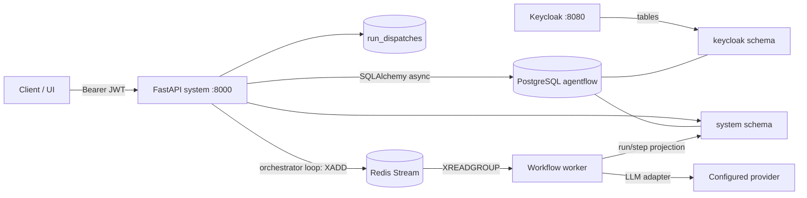
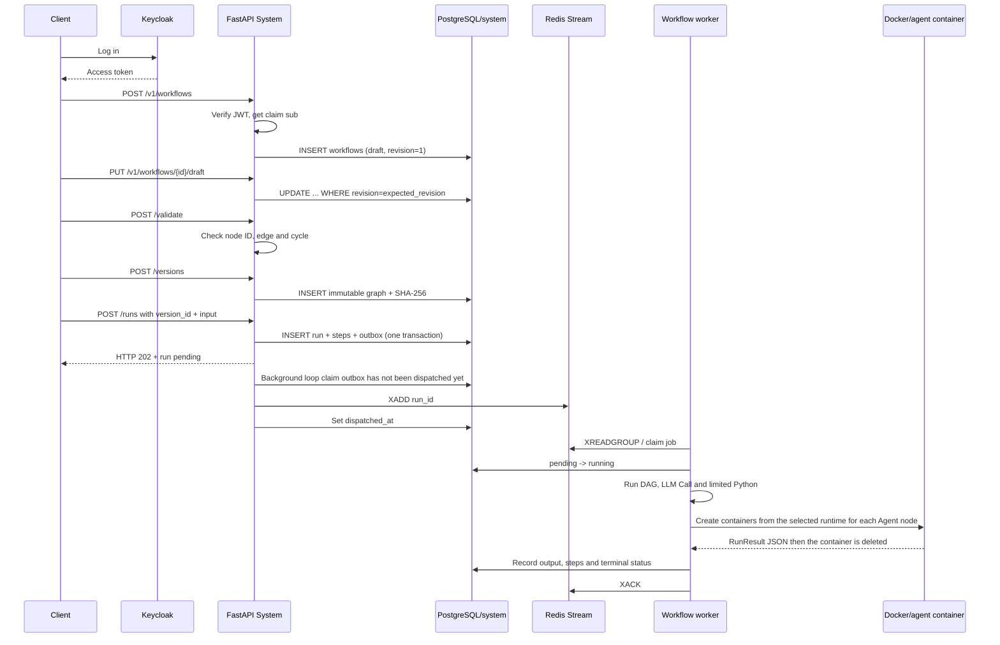
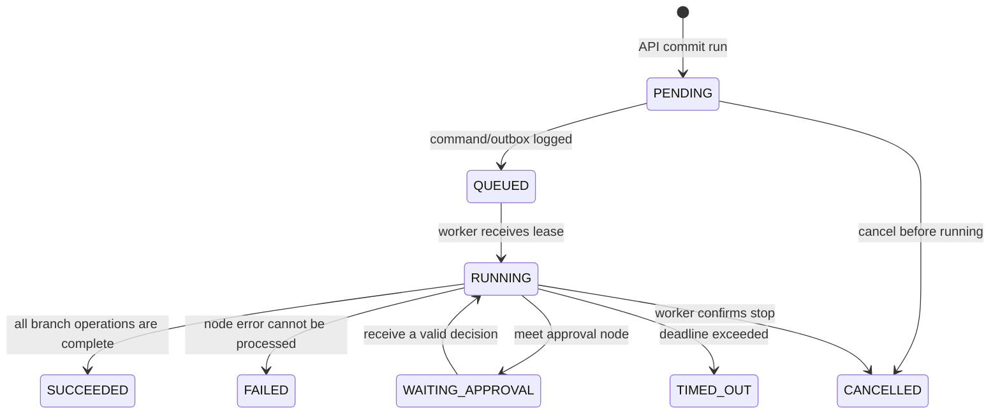

# Workflow persistence and execution

This document describes the path of data from the time a user creates a draft to the time a workflow run ends. The **existing** section reflects the code in `src/system`; The **target runtime** section describes persistent capabilities that need to be added. The detailed design for distributing ready nodes across bounded executor pools is in [parallel workflow execution](parallel-workflow-execution.md).

## 1. Service boundaries and data storage

The development environment uses a PostgreSQL database `agentflow`, but each service has its own schema:

| Ingredients | Where to save | Responsibility |
| --- | --- | --- |
| FastAPI `system` / orchestrator | schema `system` + Redis Stream | API workflow, transactional outbox and dispatch `run_id` to queue |
| Workflow workers | Do not own your own database | Claim job, run graph and update run/step projection |
| Redis | volume `agentflow_redis` | Queue at-least-once, consumer group and pending-entry list |
| Keycloak | schema `keycloak` | Realm, user, client, role, session login |
| Agent integration | No separate database | Receives request to execute agent and returns result with schema |
| Durable execution ledger | Ongoing | There is already a migration/background model for node attempt, run command and run event; worker has not yet dual-write/recover from ledger |
| Artifact storage | Not yet deployed | Large log, file, diff, checkpoint and result manifest |

The two schemas share the same PostgreSQL server/database for simple development operations. Do not create a foreign key between `system` and `keycloak`; The system only believes the identity `sub` after verifying the JWT. Sharing a database does not allow the System to read or edit Keycloak's internal tables.

`db-init` in `docker/compose.yaml` creates idempotent schema `system` and `keycloak`. Keycloak then manages the table in the `keycloak` schema, while System's Alembic manages the table and `alembic_version` in the `system` schema.



## 2. Existing tables

### `system.workflows`

This is the current edit of the workflow.

| Column | Meaning |
| --- | --- |
| `id` | Stable workflow UUID |
| `owner_subject` | Claim `sub` taken from Keycloak access token; used to limit queries by users |
| `name` | Workflow name |
| `draft` | JSONB containing node, edge and configuration being edited |
| `revision` | The revision number used for optimistic locking |
| `created_at`, `updated_at` | When to create and update projection |

When saving the draft, the client sends `expected_revision`. The `UPDATE` statement is only successful if the revision in the database is still equal to the value the client read. Two editors editing the same revision will not silently overwrite each other; The request that comes later receives HTTP `409` and must download a new draft.

### `system.workflow_versions`

Each row is a published snapshot and cannot be edited in place.

| Column | Meaning |
| --- | --- |
| `workflow_id`, `version` | Unique key of version number in a workflow |
| `graph` | Snapshot JSONB used for execution |
| `content_hash` | SHA-256 of JSON canonical to accurately identify content |
| `created_at` | Publishing time |

Run always references `workflow_version_id`, not draft. So editing the canvas after starting does not change the graph of the running run.

### `system.runs`

This is a run level state projection for API/UI.

| Column | Meaning |
| --- | --- |
| `workflow_version_id` | Snapshot workflow is selected to run |
| `owner_subject` | Keycloak subject creates run |
| `status` | `pending`, `running`, `succeeded` or `failed` |
| `input` | JSONB input of run |
| `output` | JSONB result of last node; leave blank when run fails |
| `created_at`, `updated_at` | Status creation and update time |

`runs` is the projection for API/UI to query. Redis keeps delivery state; `run_dispatches` ensures dispatch requests are logged atomically with run.

### `system.run_dispatches`

Each run has a unique outbox row. API creates `runs`, pending `run_steps` and `run_dispatches` in the same transaction. Orchestrator only marks `dispatched_at` after `XADD` succeeds; If Redis pauses, the row remains intact to try again next round.

## 3. Current execution flow



Specific steps:

1. `POST /v1/workflows` creates a draft of the token `sub`. The client cannot transmit `owner_subject` itself.
2. `PUT /v1/workflows/{id}/draft` increases revision within the same conditional update statement.
3.
4. `POST /v1/workflows/{id}/versions` only publishes the valid graph, numbers the next version and saves the hash.
5. `POST /v1/workflows/{id}/runs` verifies the version then creates run, step and outbox atomically. The API returns HTTP `202` immediately with status `pending`; it doesn't call LLM or run Python.
6. Orchestrator loop runs in the FastAPI lifecycle itself sending outboxes to Redis Stream. Workers in the consumer group claim the job by updating `pending -> running`, loading the immutable graph and then executing `input.schema`, `math.add`, `llm.call`, `agent`, `code.python` and `output.schema` according to the dependency. `llm.call` sends exactly one Chat Completions request using the host's provider/model and does not load the skill. Agent node resolve runtime id (`default`/`agent`, `codex`, `opencode` or `openhands`) from allow-list Workflow worker does not use model or credential configuration from `.env`.
7. `GET /v1/runs/{run_id}` and `/steps` return the projection being updated by the worker. UI poll every second when running is `pending/running`. If a step fails, that step is `failed`, the following steps are `skipped`, and run ends `failed`.
8. Worker points to `XACK` after the result is committed. Messages that have not been acked for more than the configured time are received by a healthy worker using `XAUTOCLAIM`.
9. `GET /v1/workflows/{id}/runs` pays up to 100 most recent runs of the workflow, newest first and only within the current user range.

`code.python` currently uses the AST evaluator for a limited Python set serving JSON transformations (`main(inputs)`, local variables, dict/list, `len`, `split`, `join`). It does not use `exec`, does not allow imports, loops or arbitrary access to the filesystem/network. A fully isolated runner still belongs to the target runtime.

`llm.call`'s prompt and `agent`'s instructions support templates according to the node's own resolved input. Use `{{input.field}}` for a single field, `{{input.nested.field}}` for nested paths, or `{{input}}` for the entire JSON. When a node has only one parent and does not declare `inputs`, the parent's output automatically becomes the node's input; A reference that does not exist causes step to fail with an obvious error.

The current engine runs ready nodes concurrently inside one run and immediately
recalculates readiness whenever a node completes. Restricted Python is executed
in a bounded thread pool so it does not block LLM or Agent I/O on the event loop.
A workflow worker still awaits one run message at a time and owns that run's
in-memory graph state. The target architecture persists ready/queued node attempts
so any compatible executor can claim them while a fenced run coordinator remains
the only authority that unlocks downstream nodes. See
[parallel workflow execution](parallel-workflow-execution.md) for the concurrency,
ordering, result collection, and migration contract.

## 4. Runtime sustainability goals

Workers are now processed according to snapshots and Redis consumer groups. Remaining advanced statuses/abilities:



A suggested processing cycle:

1. API creates `run`, `StartRun command` and outbox event in **one transaction**. Only pay `202` after commit.
2. Dispatcher claims outbox with lease and sends run to workflow worker. Resend must use the same operation key.
3. Worker loads `workflow_versions.graph`, verifies `content_hash`, creates execution status from snapshot and input.
4. Graph interpreter finds all nodes with sufficient dependencies and then runs them simultaneously up to the `settings.maxParallelNodes` limit (default 4, maximum 32). In the target node-task architecture, the coordinator persists this ready set and bounded executor workers claim individual attempts; thread timing never determines dependency order.
5. Executor resolves input mapping from `$input` and output node first; secret is only resolved right before calling connector/agent.
6. Pure Node like transform/if runs in worker. Node agent creates a persistent agent job; runner supervisor creates a disposable container for each attempt according to [ephemeral agent runtime design](ephemeral-agent-runtime.md). HTTP requests, tests, approvals and connectors use separate adapters.
7. The output schema is checked before the node switches to `SUCCEEDED`. Large output is saved as an artifact and the database only keeps reference/checksum.
8. Node `if` only activates edge `true` or `false`; node `parallel` activates every edge `parallel`. The worker propagates `SKIPPED` to the unselected branch so that the join does not crash.
9. Each state change records projection and domain event/outbox in the same transaction. The UI reads the projection and can receive events via SSE.
10. When every branch finishes, the worker records the terminal state and the run's summary output.

## 5. Additional worker data

`run_steps` now saves a light projection for the UI to see the status and input/output of each node. The following tables still need to be added when deploying persistent workers:

| Table | Main content |
| --- | --- |
| `node_attempts` | Number of attempts, lease generation, time and normalized error |
| `commands` | Start/cancel/approval command with idempotency key and payload hash |
| `run_dispatches` | Implemented: outbox dispatch run into Redis Stream |
| `run_events` | Event audit has a sequence for SSE replay |
| `agent_sessions` | Provider, session ID, runner/job reference and workspace snapshot |
| `approval_requests` | Action hash, reviewer scope, deadline and decision |
| `artifacts` | Object key, content type, size, checksum and retention |

The above tables still belong to the `system` schema in the current environment. If a service later becomes an independent data owner, it is possible to transfer the schema/database using migration without letting the integration agent directly access the System table.

### Langfuse and business history

`run_steps` is the primary data source for the history screen because it has the same ownership and lifecycle as the run workflow. Langfuse is an optional observability layer: an AgentFlow run maps to a trace, each node/LLM call to observation. Do not use Langfuse instead of `run_steps`, and do not include secrets or sensitive payloads in the trace. Local self-host is implemented using the `docker/compose.langfuse.yaml` override; See operation and input/output policy in [observability document](observability.md). Refer to [Langfuse data model](https://langfuse.com/docs/observability/data-model) and [self-hosting sizing](https://langfuse.com/self-hosting/configuration/scaling).

The metrics/logs/traces architecture, correlation rules, and monitoring stack implementation steps are described at [monitoring and observability integration](observability.md).

## 6. Transaction, retry and recovery

- Create run and command must be atomic; Don't let there be a run that the worker never knows about.
- Delivery is considered at-least-once. Every node with side effects needs `operation_key` to be stable via retry.
- Worker only claims one execution with a limited lease. Generation/fencing prevents old workers from recording results after lease loss.
- Temporary network error can be retried with backoff. Auth, policy or schema errors are not retried automatically.
- After an unknown timeout of the external API, the node passes `RECONCILIATION_REQUIRED` instead of blindly calling back.
- Agent returning the text "done" is not enough to be successful; The system must receive a valid response, check the schema, and commit the result.
- When process restarts, worker rebuilds progress from run/node projection and durable orchestration history; does not rely on tasks that only reside in FastAPI memory.

Detailed event/outbox and durable orchestration design is in [event-driven.md](event-driven.md). Node, branch and join semantics are in [workflow-spec.md](workflow-spec.md). The agent calling boundary is in [agent-integration.md](agent-integration.md).

## 7. Example data through each stage

Draft under editing:

```json
{
  "name": "Handling support requests",
  "draft": {
    "nodes": [
      { "id": "start", "type": "trigger.manual" },
      { "id": "classify", "type": "agent" },
      { "id": "done", "type": "end" }
    ],
    "edges": [
      { "from": "start", "to": "classify" },
      { "from": "classify", "to": "done" }
    ]
  }
}
```

Request to create run from published version:

```json
{
  "version_id": "6f902d28-979b-4c5f-b9dc-94bc7f29dc77",
  "input": {
    "ticket_id": "SUP-1024",
    "message": "Unable to log in"
  }
}
```

Current Projection right after API commit:

```json
{
  "id": "0d905356-02e0-48f1-9618-6fc6c53f9685",
  "workflow_version_id": "6f902d28-979b-4c5f-b9dc-94bc7f29dc77",
  "status": "succeeded",
  "input": {
    "ticket_id": "SUP-1024",
    "message": "Unable to log in"
  },
  "output": {
    "result": "..."
  }
}
```

The run row reflects the synthesis status; `run_steps` provides node details for the UI. When the worker is deployed, the attempt/retry and large log will reside in `node_attempts` with artifact storage.
